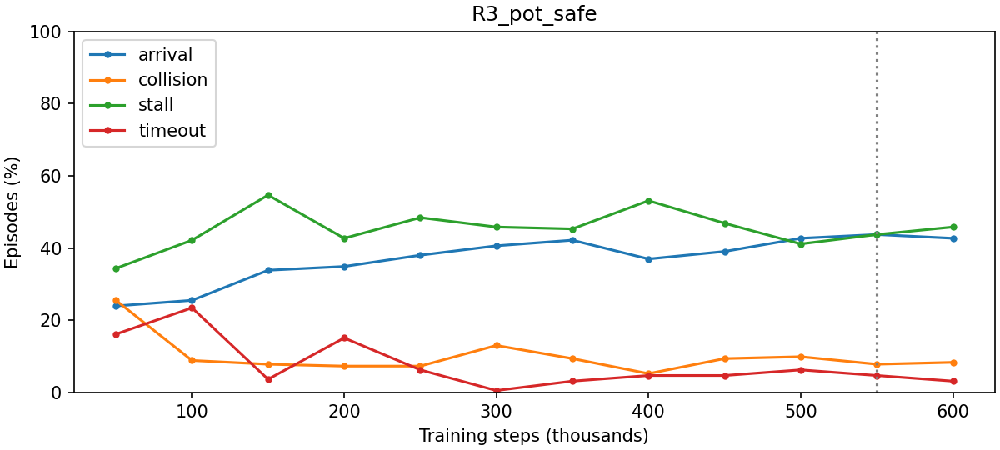

# 순수 PPO 보상 조합 비교

## 왜 비교하는가

기존 60만 스텝 독립 평가에서 도착 +5·충돌 −15는 192회 중 48회 완주했고 일반 시간초과가 57건이었다. 충돌 −5에서는 99회 완주, 일반 시간초과 1건이었으나 충돌도 27→48건으로 늘었다. 별도의 정지 진단에서 일반 시간초과 420건 중 408건이 마지막 30초에 1m 이하로 움직였다. 이번에는 목적 경로를 따라 전진하는 행동과 안전한 분기를 함께 학습하는지 본다. [기존 결과](jys3-reward-comparison.md)

전진 상한은 +3, 도착은 +5로 둔다. 과거 전진 +7·도착 0에서는 기준 모델의 충돌이 차로 끝 정지로 바뀐 34건 중 27건이 차로를 한 번도 바꾸지 않았다. 충돌 −5에서 도착만 +10으로 키우면 60만 스텝 완주가 99→71건으로 줄었다. 분기 +1은 pmh 장기 평가에서 완주가 90→111건 늘었던 값을 사용한다. 속도 편차 벌점 대신, 종료 전 속도 0.5m/s 미만이고 같은 차로 앞 간격이 25m 초과 또는 앞차가 없을 때에만 스텝당 −0.02를 적용한다. 옆 차로의 틈을 기다리는 상황도 이 조건을 만족할 수 있다.

|조건|충돌|검증할 가설|
|---|---|---|
|R1|−10 고정|기존 −5와 −15 사이에서 전진과 충돌 억제가 균형을 이루는가|
|R2|20만·40만에서 −5→−10→−15|초기에 익힌 주행을 유지하면서 후반 충돌을 줄이는가|
|R3|−10 고정|R1에 위험 잠재함수 차분을 추가하면 충돌 직전 행동이 개선되는가|

R2는 사람이 정한 충돌 벌점 스케줄이다. R3는 같은 차로의 접근시간과 옆 차로 간격·상대속도로 위험도를 계산해 보상에만 사용한다. 위험이 0인 상태의 차분은 0이다. 같은 음수 잠재값이 유지되면 할인율 때문에 작은 양수가 생긴다. 긴 에피소드에서 종료 보상이 크게 할인된다는 점은 이번 실험의 설계 근거이며, 기존 개별 주행에서 멈춘 이유는 행동 기록과 전환표로 검증한다.

## 실행·판정

학습률은 전 구간 0.0001이며 정책 입력·종료 규칙·학습 설정은 세 조건에서 동일하다. 1단계는 시드 11, 조건당 30만 스텝이다. 30만 일반 시간초과 16건 이상 또는 최고 완주 24건 이하이면 탈락한다. 통과 후보는 20만·25만·30만의 합산 완주, 충돌, 일반 시간초과, 분기 성공 순으로 비교해 1개를 승격한다. 승격 조건은 3개 시드로 60만 스텝까지 검증한다. 시드 11은 처음부터 다시 실행해 30만까지의 가중치를 체크포인트마다 대조한다. [실행 설정](../../results/jys3_ppo_comparison/pure_f/reward_mix_v1/protocol.json) · [실행 코드](../../utils/jys3_reward_mix.py)

## 승격과 종료 판단

세 조건 모두 1단계 최저 기준을 통과했다. 20만·25만·30만의 완주 횟수를 합치면 시드 11에서 R3가 92/192회, R2가 85회, R1이 72회였다. 같은 기간 충돌은 각각 16·26·19회, 일반 시간초과는 0·2·5회였다. 완주 횟수를 우선한다는 사전 기준에 따라 R3를 승격하고 R1과 R2는 30만에서 종료했다.

R3의 고교통 중간 평가에서 50만→55만→60만의 완주는 82→84→82건, 충돌은 19→15→16건, 차로 끝 정지는 79→84→88건, 일반 시간초과는 12→9→6건이었다(각 192회). 세 학습 시드의 합산 완주가 가장 높은 **55만**을 대표로 선정했다.

|고교통 독립 검증 (각 192회)|완주율|충돌률|시간초과율 (끝 정지 포함)|
|---|---:|---:|---:|
|기존 모델과 동일 조건 · 55만|44.8% (86)|9.9% (19)|45.3% (87)|
|기존 모델과 동일 조건 · 60만|43.8% (84)|8.3% (16)|47.9% (92)|
|새 평가 시드 · 55만|44.3% (85)|8.9% (17)|46.9% (90)|
|새 평가 시드 · 60만|42.7% (82)|6.25% (12)|51.0% (98)|

각 평가 시드군은 경로 16개 × 교통 시드 2개 × 출발 조건 2개로 구성된다. 같은 64개 조건을 학습 시드 3개에 적용했다.

두 독립 검증 모두 55만에서 60만으로 가면서 충돌은 줄고 완주도 줄었다. 새 시드에서 차로 끝 정지가 79→92건으로 늘었다. 60만에서 14번은 12회 모두 끝 정지였고, 13·16번은 각각 11/12회, 10번은 10/12회 끝 정지였다. 13번 진출 진단 성공은 55만 3건에서 60만 0건으로 줄었고, 16번 지정 출발 조건의 본선 복귀 성공은 두 시점 모두 0건이었다. **이번 보상 조합은 60만에서 동결하고 80만~100만 스텝 연장은 보류한다.** 수업 목표인 완주율 95%까지 대표 모델은 새 시드 기준 50.7%p 부족하다.

동일한 60만 스텝과 출발 조건에서 F1의 일반 시간초과 57건 중 R3는 36건을 완주했고 16건은 끝 정지했다. 반면 충돌 −5 기준 모델에서 완주했던 99건 중 R3도 완주한 것은 69건이고, 22건은 끝 정지로 바뀌었다. 기준 모델의 충돌 48건 중 R3가 완주한 것은 6건이고 28건은 끝 정지로 바뀌었다. 이 비교는 전진·분기·정지·충돌 보상 등이 함께 달라진 조합 전체의 결과다.

## 정량 결과

### 1단계 선별

주행 결과는 체크포인트마다 고교통 64회다. 마지막 열은 직전 5만 학습 스텝의 스텝당 평균 보상이며 순서는 전진·도착·분기·충돌·시간초과·정지 벌점·잠재함수다.

|조건|스텝|완주|충돌|끝정지|시간초과|13번 /4|16번 /2|학습 보상 평균|
|---|---:|---:|---:|---:|---:|---:|---:|---|
|R1_knox_bal|50,000|16|8|24|16|0|0|0.00620, 0.00330, 0.00262, -0.05680, -0.00130, -0.00256, 0.00000|
|R1_knox_bal|100,000|20|7|32|5|0|0|0.00596, 0.00420, 0.00286, -0.01460, -0.00580, -0.00418, 0.00000|
|R1_knox_bal|150,000|18|16|29|1|0|0|0.00628, 0.00440, 0.00320, -0.01120, -0.00690, -0.00453, 0.00000|
|R1_knox_bal|200,000|23|8|33|0|0|0|0.00646, 0.00460, 0.00322, -0.01060, -0.00650, -0.00440, 0.00000|
|R1_knox_bal|250,000|25|9|30|0|0|0|0.00575, 0.00460, 0.00290, -0.00540, -0.00700, -0.00525, 0.00000|
|R1_knox_bal|300,000|24|2|33|5|0|0|0.00562, 0.00590, 0.00298, -0.00680, -0.00340, -0.00434, 0.00000|
|R2_cpo_stage|50,000|19|7|27|11|0|0|0.00691, 0.00400, 0.00290, -0.02640, -0.00080, -0.00185, 0.00000|
|R2_cpo_stage|100,000|16|10|22|16|0|0|0.00615, 0.00490, 0.00276, -0.00900, -0.00190, -0.00292, 0.00000|
|R2_cpo_stage|150,000|20|1|31|12|0|0|0.00641, 0.00550, 0.00308, -0.00900, -0.00170, -0.00254, 0.00000|
|R2_cpo_stage|200,000|24|3|35|2|0|0|0.00751, 0.00830, 0.00384, -0.00690, -0.00060, -0.00133, 0.00000|
|R2_cpo_stage|250,000|30|11|23|0|0|0|0.00789, 0.00970, 0.00398, -0.01080, -0.00090, -0.00151, 0.00000|
|R2_cpo_stage|300,000|31|12|21|0|0|0|0.00802, 0.01000, 0.00408, -0.00820, -0.00130, -0.00151, 0.00000|
|R3_pot_safe|50,000|17|5|40|2|0|0|0.00661, 0.00330, 0.00290, -0.04880, -0.00230, -0.00253, 0.00087|
|R3_pot_safe|100,000|14|8|26|16|0|0|0.00580, 0.00450, 0.00282, -0.01560, -0.00450, -0.00409, 0.00081|
|R3_pot_safe|150,000|24|3|37|0|4|0|0.00657, 0.00510, 0.00310, -0.01160, -0.00430, -0.00414, 0.00101|
|R3_pot_safe|200,000|28|8|28|0|3|0|0.00709, 0.00680, 0.00340, -0.01000, -0.00270, -0.00319, 0.00114|
|R3_pot_safe|250,000|28|4|32|0|2|0|0.00727, 0.00820, 0.00356, -0.01020, -0.00180, -0.00257, 0.00114|
|R3_pot_safe|300,000|36|4|24|0|2|0|0.00713, 0.00830, 0.00356, -0.00860, -0.00160, -0.00210, 0.00130|

승격 조건은 R3_pot_safe이다. [판정 점수](../../results/jys3_ppo_comparison/pure_f/reward_mix_v1/stage1_summary.json)

### 2단계 중간 평가와 독립 검증

각 시드 64회, 합산 192회. 지표는 건수이며 기준 미분류 종료는 기타에 포함한다.

|조건|평가 시드군|스텝|학습 시드|완주|충돌|끝정지|일반 시간초과|기타|13번|16번|
|---|---:|---:|---|---:|---:|---:|---:|---:|---:|---:|
|R3_pot_safe|41110000|50,000|11|17|5|40|2|0|0|0|
|R3_pot_safe|41110000|50,000|22|14|16|10|24|0|0|0|
|R3_pot_safe|41110000|50,000|33|15|28|16|5|0|0|0|
|R3_pot_safe|41110000|50,000|합산|46|49|66|31|0|0|0|
|R3_pot_safe|41110000|100,000|11|14|8|26|16|0|0|0|
|R3_pot_safe|41110000|100,000|22|24|4|32|4|0|0|0|
|R3_pot_safe|41110000|100,000|33|11|5|23|25|0|0|0|
|R3_pot_safe|41110000|100,000|합산|49|17|81|45|0|0|0|
|R3_pot_safe|41110000|150,000|11|24|3|37|0|0|4|0|
|R3_pot_safe|41110000|150,000|22|22|6|32|4|0|0|0|
|R3_pot_safe|41110000|150,000|33|19|6|36|3|0|0|0|
|R3_pot_safe|41110000|150,000|합산|65|15|105|7|0|4|0|
|R3_pot_safe|41110000|200,000|11|28|8|28|0|0|3|0|
|R3_pot_safe|41110000|200,000|22|29|5|30|0|0|2|0|
|R3_pot_safe|41110000|200,000|33|10|1|24|29|0|0|0|
|R3_pot_safe|41110000|200,000|합산|67|14|82|29|0|5|0|
|R3_pot_safe|41110000|250,000|11|28|4|32|0|0|2|0|
|R3_pot_safe|41110000|250,000|22|26|7|31|0|0|1|0|
|R3_pot_safe|41110000|250,000|33|19|3|30|12|0|0|0|
|R3_pot_safe|41110000|250,000|합산|73|14|93|12|0|3|0|
|R3_pot_safe|41110000|300,000|11|36|4|24|0|0|2|0|
|R3_pot_safe|41110000|300,000|22|21|11|32|0|0|0|0|
|R3_pot_safe|41110000|300,000|33|21|10|32|1|0|0|0|
|R3_pot_safe|41110000|300,000|합산|78|25|88|1|0|2|0|
|R3_pot_safe|41110000|350,000|11|29|5|30|0|0|3|0|
|R3_pot_safe|41110000|350,000|22|30|8|26|0|0|2|0|
|R3_pot_safe|41110000|350,000|33|22|5|31|6|0|0|0|
|R3_pot_safe|41110000|350,000|합산|81|18|87|6|0|5|0|
|R3_pot_safe|41110000|400,000|11|26|2|36|0|0|0|0|
|R3_pot_safe|41110000|400,000|22|21|5|38|0|0|0|0|
|R3_pot_safe|41110000|400,000|33|24|3|28|9|0|0|0|
|R3_pot_safe|41110000|400,000|합산|71|10|102|9|0|0|0|
|R3_pot_safe|41110000|450,000|11|32|7|25|0|0|2|0|
|R3_pot_safe|41110000|450,000|22|24|6|32|2|0|0|0|
|R3_pot_safe|41110000|450,000|33|19|5|33|7|0|2|0|
|R3_pot_safe|41110000|450,000|합산|75|18|90|9|0|4|0|
|R3_pot_safe|41110000|500,000|11|32|8|19|5|0|0|1|
|R3_pot_safe|41110000|500,000|22|32|4|28|0|0|0|0|
|R3_pot_safe|41110000|500,000|33|18|7|32|7|0|2|0|
|R3_pot_safe|41110000|500,000|합산|82|19|79|12|0|2|1|
|R3_pot_safe|41110000|550,000|11|38|3|23|0|0|0|0|
|R3_pot_safe|41110000|550,000|22|26|8|30|0|0|0|0|
|R3_pot_safe|41110000|550,000|33|20|4|31|9|0|2|0|
|R3_pot_safe|41110000|550,000|합산|84|15|84|9|0|2|0|
|R3_pot_safe|41110000|600,000|11|39|4|21|0|0|1|0|
|R3_pot_safe|41110000|600,000|22|26|6|30|2|0|0|0|
|R3_pot_safe|41110000|600,000|33|17|6|37|4|0|0|0|
|R3_pot_safe|41110000|600,000|합산|82|16|88|6|0|1|0|
|R3_pot_safe|43110000|550,000|11|38|4|22|0|0|0|0|
|R3_pot_safe|43110000|550,000|22|31|5|28|0|0|0|0|
|R3_pot_safe|43110000|550,000|33|17|10|27|10|0|1|0|
|R3_pot_safe|43110000|550,000|합산|86|19|77|10|0|1|0|
|R3_pot_safe|43110000|600,000|11|41|7|16|0|0|0|0|
|R3_pot_safe|43110000|600,000|22|27|6|30|1|0|0|0|
|R3_pot_safe|43110000|600,000|33|16|3|37|8|0|0|0|
|R3_pot_safe|43110000|600,000|합산|84|16|83|9|0|0|0|
|R3_pot_safe|45110000|550,000|11|35|7|21|1|0|0|0|
|R3_pot_safe|45110000|550,000|22|29|5|29|1|0|0|0|
|R3_pot_safe|45110000|550,000|33|21|5|29|9|0|3|0|
|R3_pot_safe|45110000|550,000|합산|85|17|79|11|0|3|0|
|R3_pot_safe|45110000|600,000|11|37|4|23|0|0|0|0|
|R3_pot_safe|45110000|600,000|22|28|5|31|0|0|0|0|
|R3_pot_safe|45110000|600,000|33|17|3|38|6|0|0|0|
|R3_pot_safe|45110000|600,000|합산|82|12|92|6|0|0|0|

### 동일 조건 전환표

선정 모델끼리, 최종 모델끼리 각각 같은 출발을 비교했다. 마지막 열은 기존 완주 행에서는 완주 보존율, 실패 행에서는 완주 전환율이다.

|비교|시점|기존 종료|완주|충돌|끝정지|시간초과|기타|완주 비율|
|---|---|---|---:|---:|---:|---:|---:|---:|
|F1 → R3_pot_safe|선정|arrival|40|6|8|2|0|71.4%|
|F1 → R3_pot_safe|선정|collision|6|5|7|0|0|33.3%|
|F1 → R3_pot_safe|선정|stall|17|7|48|8|0|21.2%|
|F1 → R3_pot_safe|선정|timeout|23|1|14|0|0|60.5%|
|F1 → R3_pot_safe|최종|arrival|35|2|8|3|0|72.9%|
|F1 → R3_pot_safe|최종|collision|10|4|13|0|0|37.0%|
|F1 → R3_pot_safe|최종|stall|3|5|46|6|0|5.0%|
|F1 → R3_pot_safe|최종|timeout|36|5|16|0|0|63.2%|
|collision5 → R3_pot_safe|선정|arrival|78|8|28|6|0|65.0%|
|collision5 → R3_pot_safe|선정|collision|6|5|27|1|0|15.4%|
|collision5 → R3_pot_safe|선정|stall|1|6|22|3|0|3.1%|
|collision5 → R3_pot_safe|선정|timeout|1|0|0|0|0|100.0%|
|collision5 → R3_pot_safe|최종|arrival|69|3|22|5|0|69.7%|
|collision5 → R3_pot_safe|최종|collision|6|11|28|3|0|12.5%|
|collision5 → R3_pot_safe|최종|stall|9|2|31|1|0|20.9%|
|collision5 → R3_pot_safe|최종|timeout|0|0|1|0|0|0.0%|
|collision5 → R3_pot_safe|최종|other|0|0|1|0|0|0.0%|

