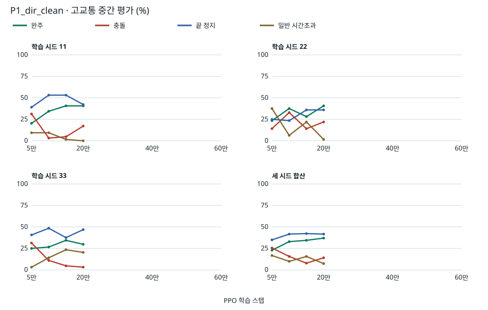

# 도로 단위 분기 방향 교정과 순수 PPO 보상 비교

## 실험을 시작한 이유

퇴계원 IC 고교통에서 충돌률 5% 미만과 완주율 95% 이상이 목표다. 1차 보상 실험 R3의 3개 시드 중간 평가에서 55만 스텝은 완주 84/192, 충돌 15, 잘못된 차로 끝 정지 84, 일반 시간초과 9건이었다. 60만에서는 각각 82·16·88·6건이었다. 이 실험은 **진행해야 할 도로를 구별하고, 맞는 차로에서 분기를 통과하는 행동**을 개선하려고 설계했다. [R3 중간 평가 원자료](../../results/jys3_ppo_comparison/pure_f/reward_mix_v1/stage2/screen.json)

| R3 · 60만 · 고교통 | 완주 / 64 | 충돌 | 끝 정지 | 일반 시간초과 | 주행당 실제 차로변경 |
|---|---:|---:|---:|---:|---:|
| 시드 11 | 39 | 4 | 21 | 0 | 5.34 |
| 시드 22 | 26 | 6 | 30 | 2 | 0.47 |
| 시드 33 | 17 | 6 | 37 | 4 | 0.77 |

시드 11의 16번 중간 평가에서는 1차로 출발 2회 모두 첫 분기 전에 0차로로 옮긴 뒤 끝 정지했다. 0차로 출발 2회도 복귀에 실패했다. 시드 22·33에서는 주행당 실제 차로변경이 1회 미만이었다. 이 결과로 도로 방향 표시와 옆 차로 위험 보상이 영향을 주었을 가능성을 점검한다. 관측 부호가 특정 행동을 일으켰다는 인과관계는 이 기록만으로 구분할 수 없다. [시드 11의 16번 1차로 출발 주행 · 교통 시드 1](../../results/jys3_ppo_comparison/pure_f/reward_mix_v1/stage2/R3_pot_safe_11/eval_41110000_600000_1.json) · [교통 시드 2](../../results/jys3_ppo_comparison/pure_f/reward_mix_v1/stage2/R3_pot_safe_11/eval_41110000_600000_3.json)

## 관측과 보상을 바꾼 근거

수업은 지도 수준의 도로 경로 안내를 허용한다. 이번에는 다가오는 분기의 두 도로 **중심선**을 진입 방향 기준 왼쪽·오른쪽 순서로 표시한다. 같은 목적 경로라면 현재 차로에 관계없이 같은 방향이 보인다. 각 차로가 어느 갈래와 물리적으로 이어지는지 나타내는 두 슬롯도 같은 좌우 순서를 사용한다. 차로를 바꿀 시점과 행동은 PPO가 결정한다. [수업 컨설팅 원문](https://github.com/bmil-ssu/Artificial-Intelligence-and-Control-for-Autonomous-Driving/blob/d8e273643d3e5b22dc954d687e1fb7f3a0a227d1/project_materials/7_Project_Consulting.md#L80-L85)

| 조건 | 공통 보상 | 추가 보상 |
|---|---|---|
| P1_dir_clean | 경로 전진 누적 최대 +3, 도착 +5, 올바른 분기 +1, 충돌 −9, 끝 정지·일반 시간초과 −8, 앞이 빈 정지 −0.03/스텝 | 없음 |
| P2_dir_ttc | P1과 동일 | 전방 TTC가 2.5초 미만이고 접근 속도가 0.5m/s를 초과할 때 위험을 계산해 잠재함수 차분 적용 |

앞이 빈 정지의 기준은 비종료 스텝에서 속도 0.5m/s 미만이면서 앞차가 없거나 앞 간격이 25m 초과인 경우다. 30초(150스텝)를 이렇게 정지하면 할인율 0.99에서 처음 149번의 스텝 벌점과 마지막 종료 벌점의 할인합은 R3에서 약 −2.67, 이번 실험에서 약 −4.12이다. 앞차가 있거나 속도가 기준을 벗어나면 실제 누적 벌점은 달라진다. 충돌 −9는 기존 R3의 −10보다 탐색 비용을 낮추면서 끝 정지 −8보다 절댓값을 크게 둔 값이다.

R3 옆 차로 위험 항은 간격·상대속도·행동에 따라 달라지고 −1.5는 안전 상태에서 최대 위험 상태로 바뀔 때의 근삿값이다. R3에서는 충돌로 잠재함수가 −1에서 0이 될 때 +1.5가 더해질 수 있었다. 두 후보 모두 옆 차로 위험 항을 뺐고, P2는 전방 잠재함수에만 계수 1을 사용하며 충돌 스텝에서 이 보상을 0으로 고정한다. P1과 P2의 비교에서는 이 전방 항의 유무만 달라진다. R3와 비교할 때에는 방향 인코딩과 공통 보상 변경이 함께 영향을 준다. [R3 보상 계산](../../utils/jys3_reward_mix.py)

## 평가 설계

두 후보 모두 전문가 데이터 없이 무작위 가중치로 시작한다. 1단계에서는 학습 시드 11·22로 각 30만 스텝까지 학습한다. 마지막 세 시점(20만·25만·30만)의 합산 완주, 낮은 쪽 시드의 완주, 충돌, 일반 시간초과, 13·16번 통과 성적 순으로 승격 후보를 비교한다. 승격 후보는 2단계에서 학습 시드 11·22·33 각각 60만 스텝까지 평가한다.

학습과 평가는 모두 고교통(시간당 15,000대)이다. 중간 평가 시드군 41110000에서 5만 스텝마다 16개 경로 × 교통 시드 2개 × 출발 조건 2개로 가중치당 64회 평가한다. 3개 시드의 합산 완주가 가장 높은 체크포인트를 대표로 삼고 동률이면 충돌이 적고 더 이른 시점을 고른다. 최종 평가는 대표와 60만 모델에 같은 두 시드군을 적용한다. 43110000은 이전 모델과 결과를 1:1로 대조하는 데 쓴다. 45110000은 이번 실험의 학습·선정에는 쓰지 않으며, 프로젝트에서는 이미 R3 검증에 사용한 시드군이다. [v1 최종 평가](jys3-reward-mix-v1.md)

## 측정 결과

### 분기 7곳과 차로 연결 슬롯

오프셋은 진입 도로 끝 중심점 기준 왼쪽을 양수로 잡은 거리(m)다. 두 도로 사이의 상대 순서로 부호를 정한다.

|진입 도로|오른쪽 도로 (−1)|좌측 오프셋(m)|출발 차로|왼쪽 도로 (+1)|좌측 오프셋(m)|출발 차로|이전 부호 변경|슬롯 일치|
|---|---|---:|---|---|---:|---|---|---|
|1063527748|169728835|-1.62|[0, 1]|797789364|3.17|[2]|반전|일치|
|169929488#0|169728799|-3.15|[0]|169929488#1|1.63|[1, 2]|반전|일치|
|170059994|1063527748|-1.60|[0, 1, 2]|844484876|4.80|[3]|반전|일치|
|52873356|37927512|-9.37|[0]|844484878#0|2.27|[0, 1, 2, 3]|유지|일치|
|544293888#0|37375274|-1.59|[0]|544293888#1|1.61|[1]|유지|일치|
|781184662#1|170059993|-2.59|[0]|781184662#2|2.60|[0, 1]|유지|일치|
|86198728|37927508|-6.36|[0]|86198725|1.59|[1, 2, 3, 4]|유지|일치|

16개 경로에서 분기별 좌우 불일치 0건. 13번 0차로 -1 · 13번 1차로 -1 · 16번 0차로 +1 · 16번 1차로 +1. [사전검증 기록](../../results/jys3_ppo_comparison/pure_f/reward_mix_v2/preflight_checks.json)

### 1단계 중간 평가

13번·14번은 두 번째 목표 분기의 통과를 센다. 16번은 첫 본선 통과를 출발 차로별로 센다. 마지막 열은 1차로 출발 후 첫 분기 전에 1→0으로 바뀌어 첫 분기 전에 끝 정지한 횟수다. 실제 변경은 동일 도로에서 관찰한 차로변경의 주행당 평균이다.

|조건|스텝|학습 시드|주행 수|완주|충돌|끝 정지|일반 시간초과|기타|실제 변경/주행|13번 진출|14번 통과|16번 0차로 복귀 통과|16번 1차로 본선 통과|16번 1→0 후 끝 정지|
|---|---:|---|---:|---:|---:|---:|---:|---:|---:|---:|---:|---:|---:|---:|
|P1_dir_clean|50,000|11|64|13 (20.3%)|20 (31.2%)|25 (39.1%)|6 (9.4%)|0|0.27|0/4|0/4|0/2|1/2|0/2|
|P1_dir_clean|50,000|22|64|15 (23.4%)|9 (14.1%)|16 (25.0%)|24 (37.5%)|0|0.23|0/4|0/4|0/2|1/2|1/2|
|P1_dir_clean|50,000|합산|128|28 (21.9%)|29 (22.7%)|41 (32.0%)|30 (23.4%)|0|0.25|0/8|0/8|0/4|2/4|1/4|
|P1_dir_clean|100,000|11|64|22 (34.4%)|2 (3.1%)|34 (53.1%)|6 (9.4%)|0|0.42|2/4|0/4|0/2|2/2|0/2|
|P1_dir_clean|100,000|22|64|24 (37.5%)|21 (32.8%)|15 (23.4%)|4 (6.2%)|0|0.59|1/4|0/4|0/2|1/2|1/2|
|P1_dir_clean|100,000|합산|128|46 (35.9%)|23 (18.0%)|49 (38.3%)|10 (7.8%)|0|0.51|3/8|0/8|0/4|3/4|1/4|
|P1_dir_clean|150,000|11|64|26 (40.6%)|3 (4.7%)|34 (53.1%)|1 (1.6%)|0|0.45|0/4|0/4|0/2|2/2|0/2|
|P1_dir_clean|150,000|22|64|18 (28.1%)|9 (14.1%)|23 (35.9%)|14 (21.9%)|0|0.81|0/4|0/4|0/2|0/2|1/2|
|P1_dir_clean|150,000|합산|128|44 (34.4%)|12 (9.4%)|57 (44.5%)|15 (11.7%)|0|0.63|0/8|0/8|0/4|2/4|1/4|
|P1_dir_clean|200,000|11|64|26 (40.6%)|11 (17.2%)|27 (42.2%)|0 (0.0%)|0|0.48|0/4|0/4|1/2|2/2|0/2|
|P1_dir_clean|200,000|22|64|26 (40.6%)|14 (21.9%)|23 (35.9%)|1 (1.6%)|0|0.47|2/4|3/4|0/2|1/2|0/2|
|P1_dir_clean|200,000|합산|128|52 (40.6%)|25 (19.5%)|50 (39.1%)|1 (0.8%)|0|0.48|2/8|3/8|1/4|3/4|0/4|
|P1_dir_clean|250,000|11|64|28 (43.8%)|3 (4.7%)|30 (46.9%)|3 (4.7%)|0|0.58|0/4|0/4|2/2|2/2|0/2|
|P1_dir_clean|250,000|22|64|25 (39.1%)|11 (17.2%)|26 (40.6%)|2 (3.1%)|0|0.44|0/4|0/4|0/2|2/2|0/2|
|P1_dir_clean|250,000|합산|128|53 (41.4%)|14 (10.9%)|56 (43.8%)|5 (3.9%)|0|0.51|0/8|0/8|2/4|4/4|0/4|
|P1_dir_clean|300,000|11|64|35 (54.7%)|7 (10.9%)|15 (23.4%)|7 (10.9%)|0|1.30|0/4|0/4|2/2|2/2|0/2|
|P1_dir_clean|300,000|22|64|23 (35.9%)|8 (12.5%)|31 (48.4%)|2 (3.1%)|0|0.23|0/4|0/4|0/2|1/2|0/2|
|P1_dir_clean|300,000|합산|128|58 (45.3%)|15 (11.7%)|46 (35.9%)|9 (7.0%)|0|0.77|0/8|0/8|2/4|3/4|0/4|
|P2_dir_ttc|50,000|11|64|16 (25.0%)|2 (3.1%)|29 (45.3%)|17 (26.6%)|0|0.00|0/4|0/4|0/2|2/2|0/2|
|P2_dir_ttc|50,000|22|64|18 (28.1%)|0 (0.0%)|28 (43.8%)|18 (28.1%)|0|0.11|0/4|0/4|0/2|2/2|0/2|
|P2_dir_ttc|50,000|합산|128|34 (26.6%)|2 (1.6%)|57 (44.5%)|35 (27.3%)|0|0.05|0/8|0/8|0/4|4/4|0/4|
|P2_dir_ttc|100,000|11|64|28 (43.8%)|0 (0.0%)|34 (53.1%)|2 (3.1%)|0|0.09|0/4|0/4|0/2|2/2|0/2|
|P2_dir_ttc|100,000|22|64|23 (35.9%)|4 (6.2%)|37 (57.8%)|0 (0.0%)|0|0.66|0/4|0/4|0/2|2/2|0/2|
|P2_dir_ttc|100,000|합산|128|51 (39.8%)|4 (3.1%)|71 (55.5%)|2 (1.6%)|0|0.38|0/8|0/8|0/4|4/4|0/4|
|P2_dir_ttc|150,000|11|64|25 (39.1%)|4 (6.2%)|35 (54.7%)|0 (0.0%)|0|0.41|0/4|0/4|0/2|2/2|0/2|
|P2_dir_ttc|150,000|22|64|20 (31.2%)|2 (3.1%)|36 (56.2%)|6 (9.4%)|0|0.58|0/4|0/4|0/2|2/2|0/2|
|P2_dir_ttc|150,000|합산|128|45 (35.2%)|6 (4.7%)|71 (55.5%)|6 (4.7%)|0|0.49|0/8|0/8|0/4|4/4|0/4|
|P2_dir_ttc|200,000|11|64|27 (42.2%)|9 (14.1%)|24 (37.5%)|4 (6.2%)|0|0.47|1/4|2/4|0/2|2/2|0/2|
|P2_dir_ttc|200,000|22|64|23 (35.9%)|2 (3.1%)|39 (60.9%)|0 (0.0%)|0|0.69|0/4|0/4|0/2|2/2|0/2|
|P2_dir_ttc|200,000|합산|128|50 (39.1%)|11 (8.6%)|63 (49.2%)|4 (3.1%)|0|0.58|1/8|2/8|0/4|4/4|0/4|
|P2_dir_ttc|250,000|11|64|28 (43.8%)|12 (18.8%)|22 (34.4%)|2 (3.1%)|0|0.20|0/4|1/4|1/2|2/2|0/2|
|P2_dir_ttc|250,000|22|64|18 (28.1%)|11 (17.2%)|35 (54.7%)|0 (0.0%)|0|0.16|0/4|0/4|0/2|2/2|0/2|
|P2_dir_ttc|250,000|합산|128|46 (35.9%)|23 (18.0%)|57 (44.5%)|2 (1.6%)|0|0.18|0/8|1/8|1/4|4/4|0/4|
|P2_dir_ttc|300,000|11|64|29 (45.3%)|4 (6.2%)|31 (48.4%)|0 (0.0%)|0|0.17|0/4|0/4|1/2|2/2|0/2|
|P2_dir_ttc|300,000|22|64|24 (37.5%)|1 (1.6%)|39 (60.9%)|0 (0.0%)|0|0.55|0/4|0/4|0/2|2/2|0/2|
|P2_dir_ttc|300,000|합산|128|53 (41.4%)|5 (3.9%)|70 (54.7%)|0 (0.0%)|0|0.36|0/8|0/8|1/4|4/4|0/4|

#### 승격 판단

|조건|20·25·30만 합산 완주 / 384|낮은 시드의 완주 / 192|충돌|일반 시간초과|13번+16번 통과|시드 22의 30만 실제 변경/주행|
|---|---:|---:|---:|---:|---:|---:|
|P1_dir_clean|163|74|54|15|17|0.23|
|P2_dir_ttc|149|65|39|6|15|0.55|

사전 규칙으로 승격한 조건은 **P1_dir_clean**이다. [판정 기록](../../results/jys3_ppo_comparison/pure_f/reward_mix_v2/stage1_summary.json)

### 2단계 고교통 중간 평가

|조건|스텝|학습 시드|주행 수|완주|충돌|끝 정지|일반 시간초과|기타|실제 변경/주행|13번 진출|14번 통과|16번 0차로 복귀 통과|16번 1차로 본선 통과|16번 1→0 후 끝 정지|
|---|---:|---|---:|---:|---:|---:|---:|---:|---:|---:|---:|---:|---:|---:|
|P1_dir_clean|50,000|11|64|13 (20.3%)|20 (31.2%)|25 (39.1%)|6 (9.4%)|0|0.27|0/4|0/4|0/2|1/2|0/2|
|P1_dir_clean|50,000|22|64|15 (23.4%)|9 (14.1%)|16 (25.0%)|24 (37.5%)|0|0.23|0/4|0/4|0/2|1/2|1/2|
|P1_dir_clean|50,000|33|64|16 (25.0%)|20 (31.2%)|26 (40.6%)|2 (3.1%)|0|0.14|0/4|0/4|0/2|0/2|0/2|
|P1_dir_clean|50,000|합산|192|44 (22.9%)|49 (25.5%)|67 (34.9%)|32 (16.7%)|0|0.21|0/12|0/12|0/6|2/6|1/6|

