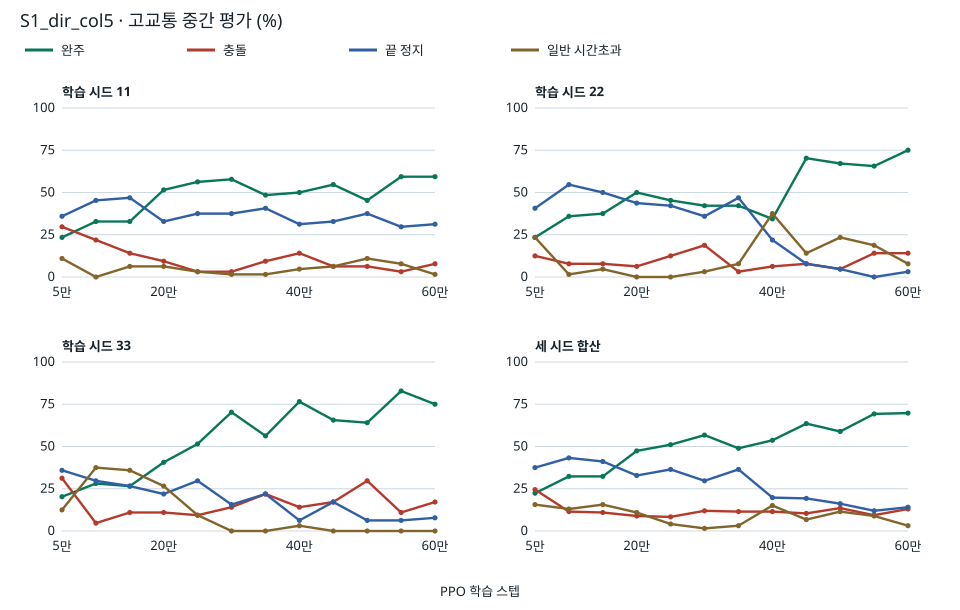

# 단순 보상에서 충돌 벌점 −5와 −7 비교

## 왜 보상을 다시 단순화했는가

학습 30만 스텝, 고교통, 학습 시드 11·22의 동일한 128회 주행을 대조했다. 이전 후보 가운데 완주가 가장 많았던 모델은 정지 중 매 스텝 벌점과 TTC 보상이 모두 0인 `collision5`였다. P2는 충돌을 가장 많이 줄였지만 주행 절반 이상이 잘못된 차로 끝에서 멈췄다. 팀 목표는 완주율 95% 이상과 충돌률 5% 미만이다.

| 기존 조건 · 각 128회 | 완주 | 충돌 | 끝 정지 | 일반 시간초과 | 시드 22 완주 / 64 | 시드 22 평균 실제 차로변경 |
|---|---:|---:|---:|---:|---:|---:|
| collision5 | 67 (52.3%) | 9 (7.0%) | 52 | 0 | 39 | 3.16 |
| R3 | 57 (44.5%) | 15 (11.7%) | 56 | 0 | 21 | 0.03 |
| P1 | 58 (45.3%) | 15 (11.7%) | 46 | 9 | 23 | 0.23 |
| P2 | 53 (41.4%) | 5 (3.9%) | 70 | 0 | 24 | 0.55 |

- **앞이 빈 정지 벌점과 끝 정지 벌점.** collision5는 정지 중 추가 벌점이 없어도 일반 시간초과가 0건이었다. P1 조합은 끝 정지가 52→46건으로 줄었고 일반 시간초과는 0→9건이었다. 옆 차로의 틈을 기다리는 정지도 P1 벌점 조건에 들 수 있다. 이번에는 스텝별 정지 벌점을 빼고 실패 종료를 −5로 통일한다.
- **전방 TTC.** 전방 TTC만 달랐던 P1→P2 비교에서 P1 충돌 15건 중 P2로 3건은 완주, 12건은 끝 정지했다. P1 완주 58건 중 15건도 끝 정지로 바뀌었다. collision5→P2에서는 기존 완주 16건과 충돌 8건이 끝 정지로 바뀌었다. 이번에는 TTC 보상을 뺀다.
- **전진과 충돌.** 시드 22는 collision5에서 실제 차로변경이 주행당 3.16회였고 R3와 P1에서는 각각 0.03·0.23회였다. 여러 보상과 관측이 함께 바뀐 비교다. 이번에는 전진 상한을 +2로 되돌리고, S1과 S2 사이에서 충돌 벌점만 바꾼다.
- **분기 통과와 방향 표시.** pmh의 60만 실험은 분기 +0.25→+1에서 완주 21건 증가, 충돌 13건 감소, 16번 0차로 복귀·완주 0→2/6을 기록했다. v2 P1의 시드 11도 25만·30만에 16번 0차로 출발 2회 모두 본선 복귀 후 완주했다. 이번 두 조건 모두 분기 +1과 v2의 도로 중심선 기준 방향 표시를 사용한다. [pmh 결과](https://github.com/jy02sung/Artificial-Intelligence-and-Control-for-Autonomous-Driving/blob/9945edbddee21a5d8968dd7248f276f7ed527f1a/docs/experiments/pmh-fork-reward-team-600k/README.md) · [v2 측정 결과](jys3-reward-mix-v2.md)

## 바꾸는 수치와 고정 조건

| 조건 | 도착 | 전진 상한 | 지정 분기 최초 통과 | 충돌 | 끝 정지·일반 시간초과·실제 경로 이탈 |
|---|---:|---:|---:|---:|---:|
| S1_dir_col5 | +5 | +2 | +1 | −5 | 각각 −5 |
| S2_dir_col7 | +5 | +2 | +1 | −7 | 각각 −5 |

S1은 이전 분기 +1 실험에서 사용한 다섯 보상 항을 따른다. S2의 충돌 벌점 절댓값 7은 도착 보너스와 전진 상한의 합이다. 실제 수익에는 할인과 분기 보상도 반영된다. −7은 −5보다 충돌을 줄이면서 완주를 유지하는지 검증하기 위해 고른 중간값이다. 두 조건 모두 앞이 빈 정지 및 TTC 보상은 0이다.

도로 단위 분기 방향은 v2와 같은 정의(+1 왼쪽 갈래, −1 오른쪽 갈래)를 쓰고 목적지와 무관한 차로 연결 슬롯도 같은 순서로 표시한다. 잘못된 차로에 있어도 아직 같은 도로에 있으면 복귀할 수 있다. 지정 경로 밖의 외부 도로에 실제 진입한 스텝은 경로 이탈로 종료하고 −5를 한 번 준다. 내부 연결로, 분기 전 정지, 충돌은 별도로 판정한다.

무작위 초기화 순수 PPO, 고교통 15,000대/시, 16개 경로, 52차원 관측, 120m 시야, 가림·노이즈 적용, 안전게이트 해제, 1,000스텝 상한, 잘못된 차로 끝 30초 정지, 학습률 0.0001을 고정한다. 1단계는 2시드 × 30만 스텝, 2단계는 승격 조건 3시드 × 60만 스텝이다. 중간 평가는 5만 스텝마다 시드당 고교통 64회다. 대표는 3개 시드의 합산 완주 최다, 충돌 최소, 이른 시점 순서로 선택한다. 43110000과 45110000은 v3 학습·선정과 분리한 교통 시드군이며, 둘 다 이전 프로젝트 실험에서 사용한 이력이 있다. 프로젝트 차원에서 새 교통 조건을 확인하기 위해 최종 전용 77110000 시드군을 추가로 사전 지정했다. 세 검증 시드군은 각각 192회다. [실행 코드](../../utils/jys3_reward_simple_v3.py)

## 측정 결과

### 이전 평가의 실제 경로 이탈 감사

체크포인트별 주행 기록을 모두 센다. 같은 모델·조건의 재평가도 한 기록으로 집계한다. 과거 궤적은 일부 도로·시간 간격만 저장하므로 확인 범위를 함께 표시했다.

|원자료|평가 파일|주행 기록|다른 외부 도로 진입 확인|경로 유지 확인|기록만으로 판별 불가|
|---|---:|---:|---:|---:|---:|
|reward_mix_v2|144|2304|0|1018|1286|
|long_600k_4|696|11136|0|5501|5635|

v3은 매 스텝 외부 도로와 지정 경로를 대조한다. 실제 경로 이탈은 이후 표에서 별도 종료 원인으로 표시한다. [분기·차로 독립성·경로 이탈·학습 사전검증](../../results/jys3_ppo_comparison/pure_f/reward_simple_v3/preflight_checks.json)

### 1단계 고교통 중간 평가

주행당 차로변경은 실제로 옆 차로로 이동한 횟수의 평균이다. 13번은 두 번째 목표 분기 진출, 16번은 첫 본선 통과를 출발 차로별로 집계했다.

|조건|스텝|학습 시드|주행 수|완주|충돌|끝 정지|일반 시간초과|실제 경로 이탈|기타|차로변경/주행|13번 진출|16번 0차로 본선|16번 1차로 본선|
|---|---:|---|---:|---:|---:|---:|---:|---:|---:|---:|---:|---:|---:|
|S1_dir_col5|50,000|11|64|15 (23.4%)|19 (29.7%)|23 (35.9%)|7 (10.9%)|0 (0.0%)|0 (0.0%)|0.00|0/4|0/2|1/2|
|S1_dir_col5|50,000|22|64|15 (23.4%)|8 (12.5%)|26 (40.6%)|15 (23.4%)|0 (0.0%)|0 (0.0%)|0.30|1/4|0/2|2/2|
|S1_dir_col5|50,000|합산|128|30 (23.4%)|27 (21.1%)|49 (38.3%)|22 (17.2%)|0 (0.0%)|0 (0.0%)|0.15|1/8|0/4|3/4|
|S1_dir_col5|100,000|11|64|21 (32.8%)|14 (21.9%)|29 (45.3%)|0 (0.0%)|0 (0.0%)|0 (0.0%)|0.03|0/4|0/2|1/2|
|S1_dir_col5|100,000|22|64|23 (35.9%)|5 (7.8%)|35 (54.7%)|1 (1.6%)|0 (0.0%)|0 (0.0%)|0.94|3/4|0/2|2/2|
|S1_dir_col5|100,000|합산|128|44 (34.4%)|19 (14.8%)|64 (50.0%)|1 (0.8%)|0 (0.0%)|0 (0.0%)|0.48|3/8|0/4|3/4|
|S1_dir_col5|150,000|11|64|21 (32.8%)|9 (14.1%)|30 (46.9%)|4 (6.2%)|0 (0.0%)|0 (0.0%)|0.31|0/4|0/2|1/2|
|S1_dir_col5|150,000|22|64|24 (37.5%)|5 (7.8%)|32 (50.0%)|3 (4.7%)|0 (0.0%)|0 (0.0%)|2.98|3/4|0/2|2/2|
|S1_dir_col5|150,000|합산|128|45 (35.2%)|14 (10.9%)|62 (48.4%)|7 (5.5%)|0 (0.0%)|0 (0.0%)|1.65|3/8|0/4|3/4|
|S1_dir_col5|200,000|11|64|33 (51.6%)|6 (9.4%)|21 (32.8%)|4 (6.2%)|0 (0.0%)|0 (0.0%)|0.34|0/4|1/2|2/2|
|S1_dir_col5|200,000|22|64|32 (50.0%)|4 (6.2%)|28 (43.8%)|0 (0.0%)|0 (0.0%)|0 (0.0%)|1.94|4/4|0/2|0/2|
|S1_dir_col5|200,000|합산|128|65 (50.8%)|10 (7.8%)|49 (38.3%)|4 (3.1%)|0 (0.0%)|0 (0.0%)|1.14|4/8|1/4|2/4|
|S1_dir_col5|250,000|11|64|36 (56.2%)|2 (3.1%)|24 (37.5%)|2 (3.1%)|0 (0.0%)|0 (0.0%)|0.73|0/4|2/2|2/2|
|S1_dir_col5|250,000|22|64|29 (45.3%)|8 (12.5%)|27 (42.2%)|0 (0.0%)|0 (0.0%)|0 (0.0%)|1.36|4/4|0/2|2/2|
|S1_dir_col5|250,000|합산|128|65 (50.8%)|10 (7.8%)|51 (39.8%)|2 (1.6%)|0 (0.0%)|0 (0.0%)|1.05|4/8|2/4|4/4|
|S1_dir_col5|300,000|11|64|37 (57.8%)|2 (3.1%)|24 (37.5%)|1 (1.6%)|0 (0.0%)|0 (0.0%)|0.38|0/4|2/2|2/2|
|S1_dir_col5|300,000|22|64|27 (42.2%)|12 (18.8%)|23 (35.9%)|2 (3.1%)|0 (0.0%)|0 (0.0%)|0.75|2/4|0/2|0/2|
|S1_dir_col5|300,000|합산|128|64 (50.0%)|14 (10.9%)|47 (36.7%)|3 (2.3%)|0 (0.0%)|0 (0.0%)|0.56|2/8|2/4|2/4|
|S2_dir_col7|50,000|11|64|19 (29.7%)|24 (37.5%)|21 (32.8%)|0 (0.0%)|0 (0.0%)|0 (0.0%)|0.42|0/4|0/2|0/2|
|S2_dir_col7|50,000|22|64|21 (32.8%)|7 (10.9%)|24 (37.5%)|12 (18.8%)|0 (0.0%)|0 (0.0%)|0.30|0/4|0/2|2/2|
|S2_dir_col7|50,000|합산|128|40 (31.2%)|31 (24.2%)|45 (35.2%)|12 (9.4%)|0 (0.0%)|0 (0.0%)|0.36|0/8|0/4|2/4|
|S2_dir_col7|100,000|11|64|21 (32.8%)|11 (17.2%)|32 (50.0%)|0 (0.0%)|0 (0.0%)|0 (0.0%)|1.02|3/4|0/2|0/2|
|S2_dir_col7|100,000|22|64|14 (21.9%)|12 (18.8%)|17 (26.6%)|21 (32.8%)|0 (0.0%)|0 (0.0%)|0.31|0/4|0/2|2/2|
|S2_dir_col7|100,000|합산|128|35 (27.3%)|23 (18.0%)|49 (38.3%)|21 (16.4%)|0 (0.0%)|0 (0.0%)|0.66|3/8|0/4|2/4|
|S2_dir_col7|150,000|11|64|20 (31.2%)|6 (9.4%)|25 (39.1%)|13 (20.3%)|0 (0.0%)|0 (0.0%)|0.95|2/4|0/2|0/2|
|S2_dir_col7|150,000|22|64|24 (37.5%)|6 (9.4%)|34 (53.1%)|0 (0.0%)|0 (0.0%)|0 (0.0%)|0.30|0/4|0/2|0/2|
|S2_dir_col7|150,000|합산|128|44 (34.4%)|12 (9.4%)|59 (46.1%)|13 (10.2%)|0 (0.0%)|0 (0.0%)|0.62|2/8|0/4|0/4|
|S2_dir_col7|200,000|11|64|19 (29.7%)|0 (0.0%)|25 (39.1%)|20 (31.2%)|0 (0.0%)|0 (0.0%)|2.16|0/4|0/2|0/2|
|S2_dir_col7|200,000|22|64|30 (46.9%)|4 (6.2%)|30 (46.9%)|0 (0.0%)|0 (0.0%)|0 (0.0%)|0.59|0/4|0/2|0/2|
|S2_dir_col7|200,000|합산|128|49 (38.3%)|4 (3.1%)|55 (43.0%)|20 (15.6%)|0 (0.0%)|0 (0.0%)|1.38|0/8|0/4|0/4|
|S2_dir_col7|250,000|11|64|28 (43.8%)|3 (4.7%)|28 (43.8%)|5 (7.8%)|0 (0.0%)|0 (0.0%)|0.86|0/4|0/2|0/2|
|S2_dir_col7|250,000|22|64|29 (45.3%)|7 (10.9%)|28 (43.8%)|0 (0.0%)|0 (0.0%)|0 (0.0%)|0.64|0/4|0/2|0/2|
|S2_dir_col7|250,000|합산|128|57 (44.5%)|10 (7.8%)|56 (43.8%)|5 (3.9%)|0 (0.0%)|0 (0.0%)|0.75|0/8|0/4|0/4|
|S2_dir_col7|300,000|11|64|48 (75.0%)|2 (3.1%)|13 (20.3%)|1 (1.6%)|0 (0.0%)|0 (0.0%)|1.42|0/4|2/2|2/2|
|S2_dir_col7|300,000|22|64|35 (54.7%)|4 (6.2%)|25 (39.1%)|0 (0.0%)|0 (0.0%)|0 (0.0%)|1.06|1/4|2/2|2/2|
|S2_dir_col7|300,000|합산|128|83 (64.8%)|6 (4.7%)|38 (29.7%)|1 (0.8%)|0 (0.0%)|0 (0.0%)|1.24|1/8|4/4|4/4|

### 30만 스텝의 동일 주행 128회 전환

각 모델 쌍에서 경로·교통 시드·출발 도로·차로·속도·위치를 대조했다.

|기존→후보|스텝|기존 종료|완주로|충돌로|끝 정지로|일반 시간초과로|경로 이탈로|기타로|합계|
|---|---|---|---:|---:|---:|---:|---:|---:|---:|
|collision5→S1_dir_col5|300,000→300,000|완주|47|6|14|0|0|0|67|
|collision5→S1_dir_col5|300,000→300,000|충돌|2|2|5|0|0|0|9|
|collision5→S1_dir_col5|300,000→300,000|끝 정지|15|6|28|3|0|0|52|
|P1_dir_clean→S1_dir_col5|300,000→300,000|완주|47|3|7|1|0|0|58|
|P1_dir_clean→S1_dir_col5|300,000→300,000|충돌|5|2|8|0|0|0|15|
|P1_dir_clean→S1_dir_col5|300,000→300,000|끝 정지|8|9|27|2|0|0|46|
|P1_dir_clean→S1_dir_col5|300,000→300,000|일반 시간초과|4|0|5|0|0|0|9|
|collision5→S2_dir_col7|300,000→300,000|완주|56|2|9|0|0|0|67|
|collision5→S2_dir_col7|300,000→300,000|충돌|5|0|4|0|0|0|9|
|collision5→S2_dir_col7|300,000→300,000|끝 정지|22|4|25|1|0|0|52|
|P1_dir_clean→S2_dir_col7|300,000→300,000|완주|54|0|4|0|0|0|58|
|P1_dir_clean→S2_dir_col7|300,000→300,000|충돌|9|2|4|0|0|0|15|
|P1_dir_clean→S2_dir_col7|300,000→300,000|끝 정지|13|4|28|1|0|0|46|
|P1_dir_clean→S2_dir_col7|300,000→300,000|일반 시간초과|7|0|2|0|0|0|9|

### 1단계 승격 근거

|조건|완주 / 384|낮은 시드 완주 / 192|충돌|끝 정지+시간초과+경로 이탈|13·16번 통과|시드 22 30만 완주 / 64|
|---|---:|---:|---:|---:|---:|---:|
|S1_dir_col5|194|88|34|156|23|27|
|S2_dir_col7|189|94|20|175|9|35|

20만·25만·30만 합계에 사전 순위를 적용한 승격 조건은 **S1_dir_col5**이다. [선별 기록](../../results/jys3_ppo_comparison/pure_f/reward_simple_v3/stage1_summary.json)

### 2단계 고교통 중간 평가

|조건|스텝|학습 시드|주행 수|완주|충돌|끝 정지|일반 시간초과|실제 경로 이탈|기타|차로변경/주행|13번 진출|16번 0차로 본선|16번 1차로 본선|
|---|---:|---|---:|---:|---:|---:|---:|---:|---:|---:|---:|---:|---:|
|S1_dir_col5|50,000|11|64|15 (23.4%)|19 (29.7%)|23 (35.9%)|7 (10.9%)|0 (0.0%)|0 (0.0%)|0.00|0/4|0/2|1/2|
|S1_dir_col5|50,000|22|64|15 (23.4%)|8 (12.5%)|26 (40.6%)|15 (23.4%)|0 (0.0%)|0 (0.0%)|0.30|1/4|0/2|2/2|
|S1_dir_col5|50,000|33|64|13 (20.3%)|20 (31.2%)|23 (35.9%)|8 (12.5%)|0 (0.0%)|0 (0.0%)|0.00|0/4|0/2|2/2|
|S1_dir_col5|50,000|합산|192|43 (22.4%)|47 (24.5%)|72 (37.5%)|30 (15.6%)|0 (0.0%)|0 (0.0%)|0.10|1/12|0/6|5/6|
|S1_dir_col5|100,000|11|64|21 (32.8%)|14 (21.9%)|29 (45.3%)|0 (0.0%)|0 (0.0%)|0 (0.0%)|0.03|0/4|0/2|1/2|
|S1_dir_col5|100,000|22|64|23 (35.9%)|5 (7.8%)|35 (54.7%)|1 (1.6%)|0 (0.0%)|0 (0.0%)|0.94|3/4|0/2|2/2|
|S1_dir_col5|100,000|33|64|18 (28.1%)|3 (4.7%)|19 (29.7%)|24 (37.5%)|0 (0.0%)|0 (0.0%)|0.28|0/4|0/2|0/2|
|S1_dir_col5|100,000|합산|192|62 (32.3%)|22 (11.5%)|83 (43.2%)|25 (13.0%)|0 (0.0%)|0 (0.0%)|0.42|3/12|0/6|3/6|
|S1_dir_col5|150,000|11|64|21 (32.8%)|9 (14.1%)|30 (46.9%)|4 (6.2%)|0 (0.0%)|0 (0.0%)|0.31|0/4|0/2|1/2|
|S1_dir_col5|150,000|22|64|24 (37.5%)|5 (7.8%)|32 (50.0%)|3 (4.7%)|0 (0.0%)|0 (0.0%)|2.98|3/4|0/2|2/2|
|S1_dir_col5|150,000|33|64|17 (26.6%)|7 (10.9%)|17 (26.6%)|23 (35.9%)|0 (0.0%)|0 (0.0%)|0.59|0/4|0/2|1/2|
|S1_dir_col5|150,000|합산|192|62 (32.3%)|21 (10.9%)|79 (41.1%)|30 (15.6%)|0 (0.0%)|0 (0.0%)|1.30|3/12|0/6|4/6|
|S1_dir_col5|200,000|11|64|33 (51.6%)|6 (9.4%)|21 (32.8%)|4 (6.2%)|0 (0.0%)|0 (0.0%)|0.34|0/4|1/2|2/2|
|S1_dir_col5|200,000|22|64|32 (50.0%)|4 (6.2%)|28 (43.8%)|0 (0.0%)|0 (0.0%)|0 (0.0%)|1.94|4/4|0/2|0/2|
|S1_dir_col5|200,000|33|64|26 (40.6%)|7 (10.9%)|14 (21.9%)|17 (26.6%)|0 (0.0%)|0 (0.0%)|0.59|0/4|0/2|2/2|
|S1_dir_col5|200,000|합산|192|91 (47.4%)|17 (8.9%)|63 (32.8%)|21 (10.9%)|0 (0.0%)|0 (0.0%)|0.96|4/12|1/6|4/6|
|S1_dir_col5|250,000|11|64|36 (56.2%)|2 (3.1%)|24 (37.5%)|2 (3.1%)|0 (0.0%)|0 (0.0%)|0.73|0/4|2/2|2/2|
|S1_dir_col5|250,000|22|64|29 (45.3%)|8 (12.5%)|27 (42.2%)|0 (0.0%)|0 (0.0%)|0 (0.0%)|1.36|4/4|0/2|2/2|
|S1_dir_col5|250,000|33|64|33 (51.6%)|6 (9.4%)|19 (29.7%)|6 (9.4%)|0 (0.0%)|0 (0.0%)|2.58|4/4|0/2|0/2|
|S1_dir_col5|250,000|합산|192|98 (51.0%)|16 (8.3%)|70 (36.5%)|8 (4.2%)|0 (0.0%)|0 (0.0%)|1.56|8/12|2/6|4/6|
|S1_dir_col5|300,000|11|64|37 (57.8%)|2 (3.1%)|24 (37.5%)|1 (1.6%)|0 (0.0%)|0 (0.0%)|0.38|0/4|2/2|2/2|
|S1_dir_col5|300,000|22|64|27 (42.2%)|12 (18.8%)|23 (35.9%)|2 (3.1%)|0 (0.0%)|0 (0.0%)|0.75|2/4|0/2|0/2|
|S1_dir_col5|300,000|33|64|45 (70.3%)|9 (14.1%)|10 (15.6%)|0 (0.0%)|0 (0.0%)|0 (0.0%)|2.44|1/4|2/2|2/2|
|S1_dir_col5|300,000|합산|192|109 (56.8%)|23 (12.0%)|57 (29.7%)|3 (1.6%)|0 (0.0%)|0 (0.0%)|1.19|3/12|4/6|4/6|
|S1_dir_col5|350,000|11|64|31 (48.4%)|6 (9.4%)|26 (40.6%)|1 (1.6%)|0 (0.0%)|0 (0.0%)|1.38|0/4|2/2|2/2|
|S1_dir_col5|350,000|22|64|27 (42.2%)|2 (3.1%)|30 (46.9%)|5 (7.8%)|0 (0.0%)|0 (0.0%)|0.91|3/4|0/2|0/2|
|S1_dir_col5|350,000|33|64|36 (56.2%)|14 (21.9%)|14 (21.9%)|0 (0.0%)|0 (0.0%)|0 (0.0%)|1.89|0/4|2/2|2/2|
|S1_dir_col5|350,000|합산|192|94 (49.0%)|22 (11.5%)|70 (36.5%)|6 (3.1%)|0 (0.0%)|0 (0.0%)|1.39|3/12|4/6|4/6|
|S1_dir_col5|400,000|11|64|32 (50.0%)|9 (14.1%)|20 (31.2%)|3 (4.7%)|0 (0.0%)|0 (0.0%)|1.50|0/4|1/2|2/2|
|S1_dir_col5|400,000|22|64|22 (34.4%)|4 (6.2%)|14 (21.9%)|24 (37.5%)|0 (0.0%)|0 (0.0%)|0.64|2/4|0/2|2/2|
|S1_dir_col5|400,000|33|64|49 (76.6%)|9 (14.1%)|4 (6.2%)|2 (3.1%)|0 (0.0%)|0 (0.0%)|1.95|4/4|2/2|2/2|
|S1_dir_col5|400,000|합산|192|103 (53.6%)|22 (11.5%)|38 (19.8%)|29 (15.1%)|0 (0.0%)|0 (0.0%)|1.36|6/12|3/6|6/6|
|S1_dir_col5|450,000|11|64|35 (54.7%)|4 (6.2%)|21 (32.8%)|4 (6.2%)|0 (0.0%)|0 (0.0%)|0.67|0/4|1/2|2/2|
|S1_dir_col5|450,000|22|64|45 (70.3%)|5 (7.8%)|5 (7.8%)|9 (14.1%)|0 (0.0%)|0 (0.0%)|1.36|3/4|2/2|2/2|
|S1_dir_col5|450,000|33|64|42 (65.6%)|11 (17.2%)|11 (17.2%)|0 (0.0%)|0 (0.0%)|0 (0.0%)|1.66|4/4|0/2|0/2|
|S1_dir_col5|450,000|합산|192|122 (63.5%)|20 (10.4%)|37 (19.3%)|13 (6.8%)|0 (0.0%)|0 (0.0%)|1.23|7/12|3/6|4/6|
|S1_dir_col5|500,000|11|64|29 (45.3%)|4 (6.2%)|24 (37.5%)|7 (10.9%)|0 (0.0%)|0 (0.0%)|0.33|0/4|1/2|2/2|
|S1_dir_col5|500,000|22|64|43 (67.2%)|3 (4.7%)|3 (4.7%)|15 (23.4%)|0 (0.0%)|0 (0.0%)|1.20|4/4|2/2|2/2|
|S1_dir_col5|500,000|33|64|41 (64.1%)|19 (29.7%)|4 (6.2%)|0 (0.0%)|0 (0.0%)|0 (0.0%)|1.80|2/4|2/2|2/2|
|S1_dir_col5|500,000|합산|192|113 (58.9%)|26 (13.5%)|31 (16.1%)|22 (11.5%)|0 (0.0%)|0 (0.0%)|1.11|6/12|5/6|6/6|
|S1_dir_col5|550,000|11|64|38 (59.4%)|2 (3.1%)|19 (29.7%)|5 (7.8%)|0 (0.0%)|0 (0.0%)|1.20|1/4|2/2|2/2|
|S1_dir_col5|550,000|22|64|42 (65.6%)|9 (14.1%)|0 (0.0%)|12 (18.8%)|1 (1.6%)|0 (0.0%)|1.42|2/4|2/2|2/2|
|S1_dir_col5|550,000|33|64|53 (82.8%)|7 (10.9%)|4 (6.2%)|0 (0.0%)|0 (0.0%)|0 (0.0%)|1.42|3/4|2/2|2/2|
|S1_dir_col5|550,000|합산|192|133 (69.3%)|18 (9.4%)|23 (12.0%)|17 (8.9%)|1 (0.5%)|0 (0.0%)|1.35|6/12|6/6|6/6|
|S1_dir_col5|600,000|11|64|38 (59.4%)|5 (7.8%)|20 (31.2%)|1 (1.6%)|0 (0.0%)|0 (0.0%)|1.45|0/4|2/2|2/2|
|S1_dir_col5|600,000|22|64|48 (75.0%)|9 (14.1%)|2 (3.1%)|5 (7.8%)|0 (0.0%)|0 (0.0%)|1.70|1/4|0/2|2/2|
|S1_dir_col5|600,000|33|64|48 (75.0%)|11 (17.2%)|5 (7.8%)|0 (0.0%)|0 (0.0%)|0 (0.0%)|1.92|4/4|0/2|1/2|
|S1_dir_col5|600,000|합산|192|134 (69.8%)|25 (13.0%)|27 (14.1%)|6 (3.1%)|0 (0.0%)|0 (0.0%)|1.69|5/12|2/6|5/6|

중간 평가에서 선택한 대표는 **600,000스텝**이다.

### 최종 검증 · 교통 시드군 43110000

|조건|스텝|학습 시드|주행 수|완주|충돌|끝 정지|일반 시간초과|실제 경로 이탈|기타|차로변경/주행|13번 진출|16번 0차로 본선|16번 1차로 본선|
|---|---:|---|---:|---:|---:|---:|---:|---:|---:|---:|---:|---:|---:|
|S1_dir_col5|600,000|11|64|37 (57.8%)|4 (6.2%)|20 (31.2%)|2 (3.1%)|1 (1.6%)|0 (0.0%)|2.08|1/4|2/2|2/2|
|S1_dir_col5|600,000|22|64|49 (76.6%)|9 (14.1%)|4 (6.2%)|2 (3.1%)|0 (0.0%)|0 (0.0%)|1.39|4/4|1/2|2/2|
|S1_dir_col5|600,000|33|64|48 (75.0%)|9 (14.1%)|7 (10.9%)|0 (0.0%)|0 (0.0%)|0 (0.0%)|2.00|3/4|1/2|0/2|
|S1_dir_col5|600,000|합산|192|134 (69.8%)|22 (11.5%)|31 (16.1%)|4 (2.1%)|1 (0.5%)|0 (0.0%)|1.82|8/12|4/6|4/6|

### 최종 검증 · 교통 시드군 45110000

|조건|스텝|학습 시드|주행 수|완주|충돌|끝 정지|일반 시간초과|실제 경로 이탈|기타|차로변경/주행|13번 진출|16번 0차로 본선|16번 1차로 본선|
|---|---:|---|---:|---:|---:|---:|---:|---:|---:|---:|---:|---:|---:|
|S1_dir_col5|600,000|11|64|39 (60.9%)|4 (6.2%)|20 (31.2%)|1 (1.6%)|0 (0.0%)|0 (0.0%)|2.09|1/4|2/2|2/2|
|S1_dir_col5|600,000|22|64|51 (79.7%)|6 (9.4%)|3 (4.7%)|4 (6.2%)|0 (0.0%)|0 (0.0%)|1.41|3/4|1/2|2/2|
|S1_dir_col5|600,000|33|64|48 (75.0%)|10 (15.6%)|6 (9.4%)|0 (0.0%)|0 (0.0%)|0 (0.0%)|1.53|0/4|0/2|0/2|
|S1_dir_col5|600,000|합산|192|138 (71.9%)|20 (10.4%)|29 (15.1%)|5 (2.6%)|0 (0.0%)|0 (0.0%)|1.68|4/12|3/6|4/6|

### 최종 검증 · 교통 시드군 77110000

|조건|스텝|학습 시드|주행 수|완주|충돌|끝 정지|일반 시간초과|실제 경로 이탈|기타|차로변경/주행|13번 진출|16번 0차로 본선|16번 1차로 본선|
|---|---:|---|---:|---:|---:|---:|---:|---:|---:|---:|---:|---:|---:|
|S1_dir_col5|600,000|11|64|39 (60.9%)|3 (4.7%)|22 (34.4%)|0 (0.0%)|0 (0.0%)|0 (0.0%)|1.78|0/4|2/2|2/2|
|S1_dir_col5|600,000|22|64|43 (67.2%)|11 (17.2%)|3 (4.7%)|7 (10.9%)|0 (0.0%)|0 (0.0%)|1.58|1/4|1/2|2/2|
|S1_dir_col5|600,000|33|64|55 (85.9%)|4 (6.2%)|5 (7.8%)|0 (0.0%)|0 (0.0%)|0 (0.0%)|1.94|4/4|0/2|1/2|
|S1_dir_col5|600,000|합산|192|137 (71.4%)|18 (9.4%)|30 (15.6%)|7 (3.6%)|0 (0.0%)|0 (0.0%)|1.77|5/12|3/6|5/6|

### 동일 주행 192회 · 대표 모델끼리 비교

|기존→후보|스텝|기존 종료|완주로|충돌로|끝 정지로|일반 시간초과로|경로 이탈로|기타로|합계|
|---|---|---|---:|---:|---:|---:|---:|---:|---:|
|collision5→S1_dir_col5|550,000→600,000|완주|99|11|9|1|0|0|120|
|collision5→S1_dir_col5|550,000→600,000|충돌|22|8|6|2|1|0|39|
|collision5→S1_dir_col5|550,000→600,000|끝 정지|12|3|16|1|0|0|32|
|collision5→S1_dir_col5|550,000→600,000|일반 시간초과|1|0|0|0|0|0|1|
|F1→S1_dir_col5|550,000→600,000|완주|51|2|3|0|0|0|56|
|F1→S1_dir_col5|550,000→600,000|충돌|8|1|9|0|0|0|18|
|F1→S1_dir_col5|550,000→600,000|끝 정지|51|13|12|4|0|0|80|
|F1→S1_dir_col5|550,000→600,000|일반 시간초과|24|6|7|0|1|0|38|
|R3_pot_safe→S1_dir_col5|550,000→600,000|완주|76|6|3|1|0|0|86|
|R3_pot_safe→S1_dir_col5|550,000→600,000|충돌|13|3|3|0|0|0|19|
|R3_pot_safe→S1_dir_col5|550,000→600,000|끝 정지|40|10|23|3|1|0|77|
|R3_pot_safe→S1_dir_col5|550,000→600,000|일반 시간초과|5|3|2|0|0|0|10|

### 동일 주행 192회 · 60만 모델끼리 비교

|기존→후보|스텝|기존 종료|완주로|충돌로|끝 정지로|일반 시간초과로|경로 이탈로|기타로|합계|
|---|---|---|---:|---:|---:|---:|---:|---:|---:|
|collision5→S1_dir_col5|600,000→600,000|완주|87|5|6|1|0|0|99|
|collision5→S1_dir_col5|600,000→600,000|충돌|27|7|13|0|1|0|48|
|collision5→S1_dir_col5|600,000→600,000|끝 정지|19|9|12|3|0|0|43|
|collision5→S1_dir_col5|600,000→600,000|일반 시간초과|1|0|0|0|0|0|1|
|collision5→S1_dir_col5|600,000→600,000|기타|0|1|0|0|0|0|1|
|F1→S1_dir_col5|600,000→600,000|완주|44|2|2|0|0|0|48|
|F1→S1_dir_col5|600,000→600,000|충돌|16|2|8|1|0|0|27|
|F1→S1_dir_col5|600,000→600,000|끝 정지|38|11|10|1|0|0|60|
|F1→S1_dir_col5|600,000→600,000|일반 시간초과|36|7|11|2|1|0|57|
|R3_pot_safe→S1_dir_col5|600,000→600,000|완주|73|5|6|0|0|0|84|
|R3_pot_safe→S1_dir_col5|600,000→600,000|충돌|10|1|3|1|1|0|16|
|R3_pot_safe→S1_dir_col5|600,000→600,000|끝 정지|47|13|20|3|0|0|83|
|R3_pot_safe→S1_dir_col5|600,000→600,000|일반 시간초과|4|3|2|0|0|0|9|

### 60만 이후 판단

50만·55만·60만의 192회 중간 평가 완주는 각각 113·133·134건이었다.
대표와 최종이 같은 60만 스텝이므로 세 교통 시드군에서 각각 한 번씩 검증했다.

55만에서 60만으로 갈 때 완주는 133→134건, 충돌은 18→25건이었다. 세 교통 시드군을 대상으로 한 최종 검증에서 목표를 충족하지 못해 이번 실험은 60만에서 마쳤다.
