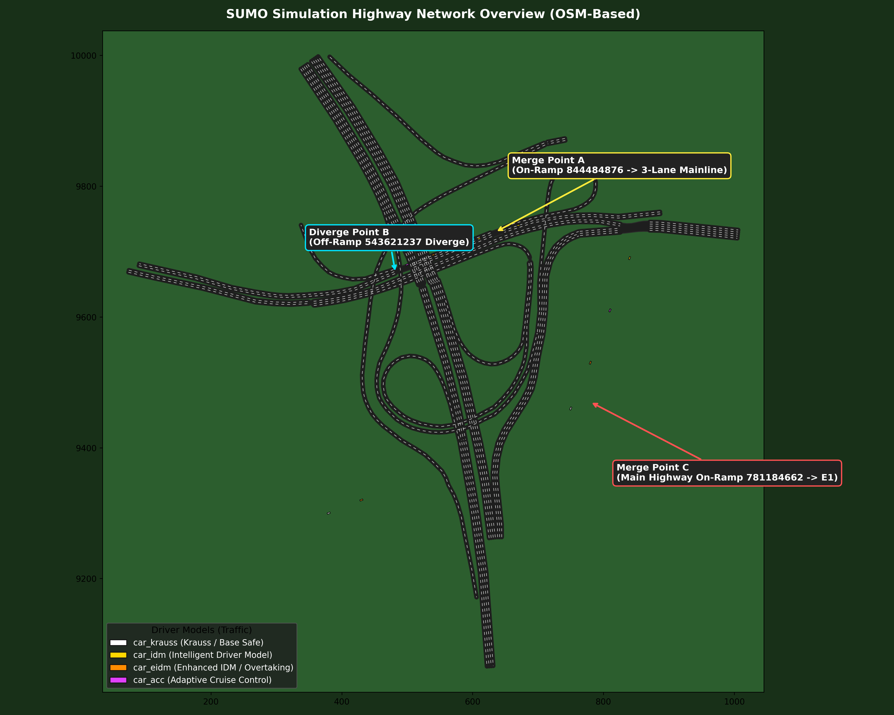

# 실제 도로망 시뮬레이션 맵 및 교통류 가이드

본 문서는 시뮬레이션에 적용된 실제 도로망(OSM 기반)의 구조, 주요 합류/분기 구간, 그리고 배경 교통류를 구성하는 4종 운전자 모델에 대한 설명입니다.

---

## 1. 도로망 개요
- **기반 데이터**: OpenStreetMap(OSM) 실제 고속도로 및 인터체인지 구간 좌표(`map.osm`) 추출 후 SUMO 네트워크(`map.net.xml`)로 정밀 컴파일
- **전체 규모**: 약 1km x 1km 영역, 본선 및 램프 포함 총 15개 주행 라우트(`r0` ~ `r14`)
- **실행 및 확인**:
  ```bash
  python view_road.py
  ```
  명령어로 SUMO-GUI 상에서 도로망 구조와 주행 차량들을 직접 확인할 수 있습니다.



---

## 2. 주요 합류(Merge) 및 분기(Diverge) 구간

시뮬레이션 도로망은 자율주행 차량이 다양한 교통 상호작용(차선 변경, 양보, 가속 합류, 감속 분기)을 학습할 수 있도록 설계되었습니다.

```
       [ 온램프 844484876 ]
               \ (합류 A)
[ 본선 169929503#0 ] ───▶ [ 3차선 확장 169929503#1 ] ───▶ [ 본선 169929503#3 ]
                                    \ (분기 B)
                                  [ 오프램프 543621237 ]
```

### ① 합류부 A (Merge Point A: 온램프 합류 및 3차선 확장)
* **위치**: 교차로 노드 `1810880137`
* **구조**:
  * 본선 2차선(`169929503#0`) + 온램프 1차선(`844484876`) ➔ **3차선 본선(`169929503#1`)**
* **동작 특성**:
  * 온램프 차량이 본선의 가장 우측 차선(0번 차선)으로 가속 합류합니다.
  * 본선 직진 차량(1차선, 2차선)은 기하학적 단차나 감속 없이 매끄럽게 통과합니다.

### ② 분기부 B (Diverge Point B: 오프램프 분기 및 2차선 축소)
* **위치**: 교차로 노드 `1810880186`
* **구조**:
  * 3차선 본선(`169929503#1`) ➔ **오프램프 1차선(`543621237`) + 본선 2차선(`169929503#3`)**
* **동작 특성**:
  * 가장 우측 차선(0번 차선)의 차량이 감속차로를 거쳐 오프램프로 빠져나갑니다.
  * 본선 주행 차량(1차선, 2차선)은 직진 본선으로 계속 주행합니다.

### ③ 합류부 C (Merge Point C: 메인 고속도로 온램프 합류)
* **위치**: 교차로 `E0` ➔ `E1` (노드 `center`)
* **구조**:
  * 메인 본선(`1063527748`)에 고속도로 진입 온램프(`781184662#0`)가 측면 합류
* **동작 특성**:
  * 자율주행 에이전트의 기본 경로(`r0`, 약 693m) 주행 중 우측에서 진입하는 합류 차량과 상호작용하는 핵심 구간입니다.

---

## 3. 배경 교통류 운전자 모델 (4종)

단일한 운전 패턴의 한계를 극복하고, 추월 및 차선 변경이 자연스럽게 유도되도록 성향과 특성이 서로 다른 **4가지 운전자 추종 모델(Car-Following Models)**을 적용했습니다.

| 모델 ID | 추종 모델 | 색상 / 차종 | 운전 성향 및 주요 특성 |
| :--- | :--- | :--- | :--- |
| **`car_krauss`** | Krauss | **흰색 (White)**<br>Sedan | **안전 중심 기본 모델**: SUMO 표준 모델로, 앞차와의 안전거리를 엄격히 유지하며 급가속/급감속 없이 정석 주행 |
| **`car_idm`** | IDM | **노란색 (Yellow)**<br>Hatchback | **인간 운전자 모사**: 가속과 감속이 연속적이고 부드러우며, 앞차 속도 변화에 민감하게 반응하여 자연스러운 교통 흐름 형성 |
| **`car_eidm`** | Enhanced IDM | **주황색 (Orange)**<br>Wagon | **적극적 추월/가속**: 도로 곡률 및 속도 편차에 유연하게 적응하며, 차선 변경 및 가속 반응이 상대적으로 빠름 |
| **`car_acc`** | ACC | **마젠타 (Magenta)**<br>Sedan | **스마트 크루즈 컨트롤**: 자율주행 레이더 센서 기반의 정밀한 차간 거리 제어 및 빠른 목표 속도 복원 |

### 차선 변경(Lane Change) 정책
* **모델**: LC2013 알고리즘 적용
* **전략적 차선 변경 (`lcStrategic = 1.0`)**: 경로 진행을 위해 필요한 차선 변경을 적극적으로 수행
* **협조적 양보 (`lcCooperative = 1.0`)**: 옆 차선에서 합류하거나 추월하려는 차량에게 감속 양보
