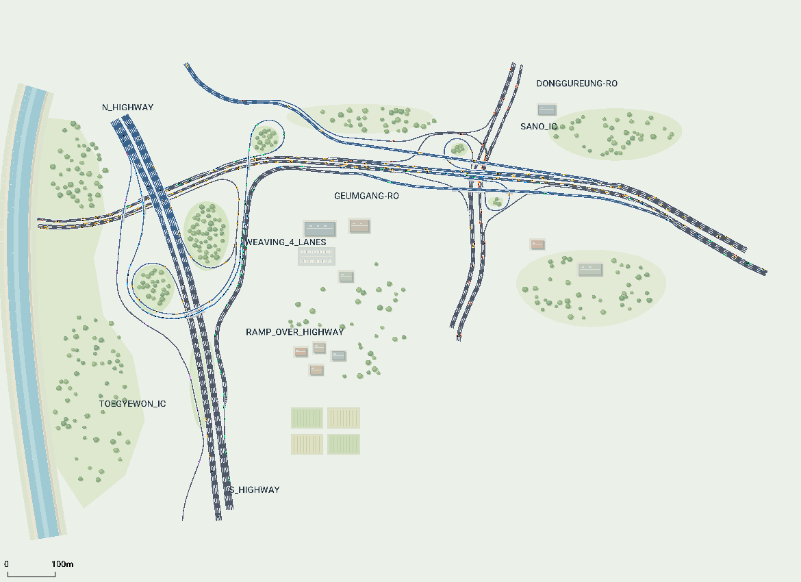
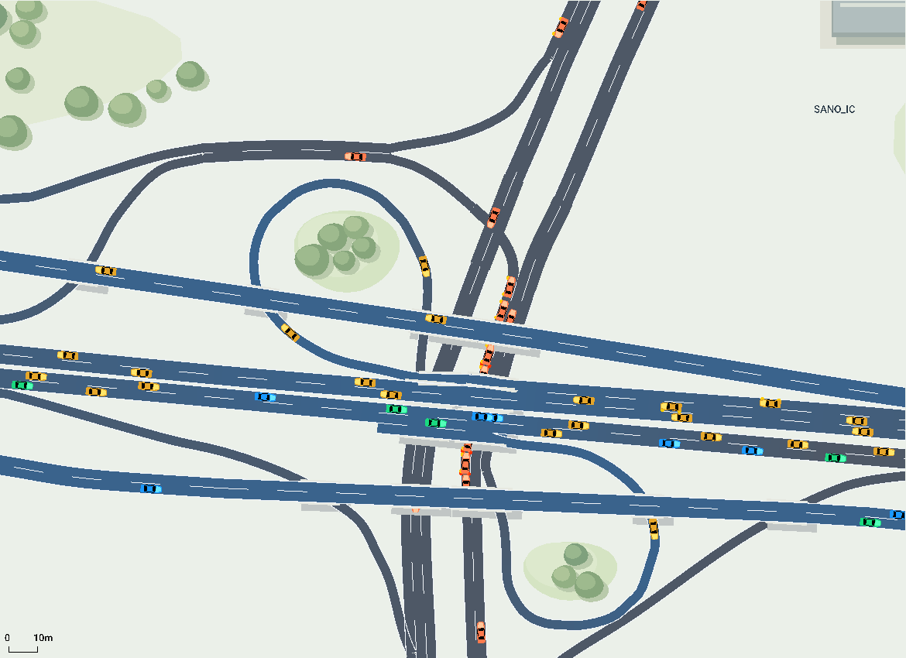
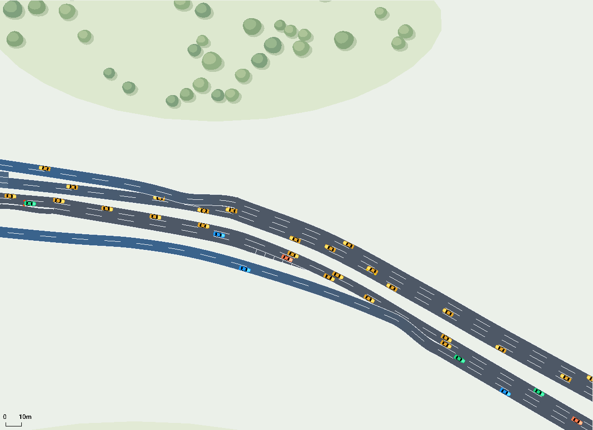

# 퇴계원·사노 IC 연결 도로

기존 퇴계원 IC 동쪽에 사노 IC를 연결했습니다. 사용자가 제공한 위성사진과 OpenStreetMap 중심선을 참고한 교육용 모델입니다. 기존 스켈레톤의 폴더, 함수 인터페이스, 학습 코드를 유지합니다.



## 백업과 작업 브랜치

- 추가 전 도로: `662fd15d5cc789bcae25ae3563b125a0f5ab6374`.
- 이 PC의 백업 브랜치: `backup/toegyewon-ic-2026-10-30`.
- 확장 작업 브랜치: `kyh-sano-ic`.
- 프로젝트 상위 `outputs/backups/`에 ZIP, 전체 Git 이력 bundle, SHA-256 검사 기록과 복원 안내를 보관했습니다. ZIP CRC, 핵심 파일 비교, bundle 검증을 통과했습니다.
- ZIP은 새 폴더에 풀고 그 안에서 `python view_road.py`로 이전 도로를 실행할 수 있습니다. ZIP 안에는 도로 소스, SUMO 생성 파일과 주변 환경이 포함됩니다.

Git 백업으로 돌아가려면 현재 변경을 커밋한 상태에서 `git switch backup/toegyewon-ic-2026-10-30`을 실행합니다. 확장본으로 복귀하려면 `git switch kyh-sano-ic`을 실행합니다. 이 두 브랜치는 현재 로컬 브랜치입니다.

## 실행

SUMO와 Python 패키지가 설치된 기존 환경에서 저장소 루트를 VS Code로 열고, CMD에서 실행합니다.

```bat
python view_road.py
```

기본 화면은 두 IC 전체 보기입니다. ▶로 재생하고 마우스 휠로 사노 IC를 확대할 수 있습니다. 기존 차량 표시 1.5배, Delay 300ms, 시뮬레이션 스텝 0.2초를 유지했습니다.

```bat
python view_road.py --nogui --seconds 1200
python view_road.py --netedit
```

실행할 때 `env/sumo/highway.*`가 재생성되므로 영구 도로 수정은 `env/road_config.py`에서 합니다.

## 추가한 도로

- 금강로 본선을 동쪽까지 연장하고 사노 IC 진출입을 연결했습니다.
- 동구릉로 남·북행, 북서쪽 루프와 남동쪽 루프를 추가했습니다.
- 본선 양옆의 연결도로와 교량, 동쪽 합류부, 북서쪽 외부 출구를 추가했습니다.
- 사진·지도에서 확인한 여섯 방향 전환과 남북 직진을 구현했습니다. 모든 방향으로 회전 가능한 교차로를 가정하지 않았습니다.
- 가속·감속 차로를 따로 연결해 합류·분기부의 차로 겹침을 줄였습니다.
- 사노 IC 루프의 녹지, 나무와 주변 건물도 추가했습니다. 배경은 실제 측량값이 아닌 장식입니다.

외부 도로 구간은 39개에서 **74개**, 차로 연결은 72개에서 **140개**, 차량 경로는 13개에서 **23개**가 됐습니다. 기존 39개 중 35개 도로 형상은 그대로이며, 동쪽 연결에 필요한 `east_accel`, `east_out`, `east_service_out`, `west_in`의 고도 또는 구간 분할만 수정했습니다. 기존 자율주행 차량의 `north_to_west` 경로는 유지했습니다.





## 교량과 모델 가정

동구릉로는 지상 0m, 사노 IC 금강로 교량은 8m, 바깥 연결도로 교량은 16m로 구분했습니다. 상하 순서는 지도 정보를 참고했지만 **숫자 높이는 모델용 가정**입니다. 교량 아래 도로와는 노드·차로를 연결하지 않습니다.

차로 수가 지도에 없는 구간은 편도 2차로와 보조 차로를 기본으로 구성했습니다. 북쪽 고가 연결도로는 상류 4차로 분기를 자연스럽게 잇기 위해 일부 OSM 3차로 표기 구간을 2차로로 단순화했습니다. 북서쪽 연결도로의 더 먼 고속도로 접속은 범위 밖으로 두고 외부 출구로 마무리했습니다.

동구릉로 북쪽의 지상 좌회전 교차부는 우선순위 교차로입니다. 맞은편 차로를 침범하지 않는 곳에서 대기하도록 교차부 영역과 정지 위치를 설정했습니다. SUMO의 내부 연결·충돌 검사는 유지하며, 해당 좌회전의 교차부 내부 대기점만 `contPos=0`으로 없앴습니다. [SUMO 연결 속성 문서](https://sumo.dlr.de/docs/Networks/PlainXML.html)를 참고했습니다.

## 차량과 교통량

기존 회색·파랑·초록·보라·노랑 색의 의미는 유지합니다. 새 **주황색**은 동구릉로 남·북쪽 경계에서 들어오는 일반 차량입니다. 색은 출발 경로에 따라 고정되며 다리를 통과해도 바뀌지 않습니다. 빨간 `ego_demo` 역시 일반 SUMO 제어기를 사용하는 확인용 차량입니다.

기존 금강로 직진 교통량 일부를 새 진출 경로로 나눴고, 동구릉로 경계 유입을 추가했습니다. 전체 합성 수요는 14,420대/시간을 0~500초에 투입합니다. 실제 교통량 조사값이나 학습된 정책의 성능 결과는 아닙니다.

## 교량 사이 차로 정리 (2026-10-30)

동구릉로의 양방향 차로 간격을 확보하고 남동쪽 루프를 북행 **오른쪽 보조 차로**에 연결했습니다. 북쪽 좌회전은 별도 왼쪽 차로에서 처리합니다. 위쪽 합류 후 분기까지의 공통 구간은 약 11m에서 64m로 늘려 급하게 갈라지는 형상을 다듬었습니다.

교량 사이 검사 구간(y=140~199m, 유효 단면 59개)에서 양방향 포장 경계 간 최소 간격은 7.335m입니다. 도로 간격과 교차부 영역은 보기 쉬운 교육용 모델을 위한 조정값입니다. 차량 경로·색·유입량은 그대로 유지했습니다.

[차로 정리 후 검증](assets/sano/corridor_validation.json): seed 42, 7, 23에서 각각 2,015대 전원 도착, 충돌·긴급 정지·긴급 제동·텔레포트 0회. 아래의 초기 확장 검증과 구분해 기록했습니다.

## 초기 확장 검증

[검증 기록](assets/sano/validation.json)에 실행 결과와 보존한 파일 목록을 기록했습니다.

- seed 42, 7, 23에서 각 1,200초 실행: **2,015대 전원 도착**.
- 세 실행 모두 충돌, 긴급 정지, 긴급 제동, 텔레포트 0회. 종료 시 주행·삽입 대기 차량 0대.
- 모든 명시적 차로 연결이 생성 결과에 존재하고, 23개 경로 모두 연속적으로 연결됨.
- 서로 연결하지 않은 도로 중심선 교차는 모두 높이 차이 4m 이상.
- 팀의 기존 `train.REWARD`로 Gym reset + 25스텝 통과: 관측 31차원, 행동 2차원.
- `train.py`, `train_bc.py`, `collect_pomdp_data.py`, `test.py`, `view_road.py`, `algorithms/`, `utils/`, `env/sumo_env.py`의 기존 Python 파일은 백업 커밋과 동일.

도로 관련 Python 변경은 `env/road_config.py`, `env/road_builder.py`, `env/mdp_config.py` 세 파일입니다. 전체 정책 재학습이나 실제 교통량에 대한 보정은 수행하지 않았습니다.

## 출처

© OpenStreetMap contributors, [ODbL 출처와 이용 안내](https://www.openstreetmap.org/copyright). 사용자가 제공한 네이버 위성사진은 형상 대조용으로 참고했습니다. [사노 IC 지도](https://www.openstreetmap.org/#map=17/37.6415/127.1402)와 [구간별 출처·가정](../project_materials/sano_geometry_sources.json)을 함께 보관합니다. 기존 퇴계원 IC의 출처는 [이전 자료](../project_materials/toegyewon_geometry_sources.json)에 있습니다.
