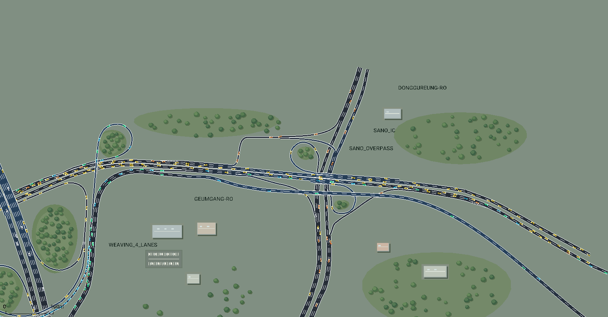
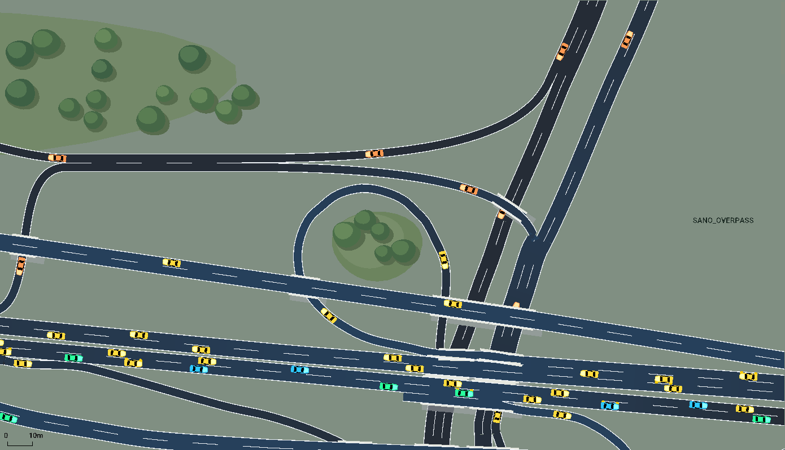
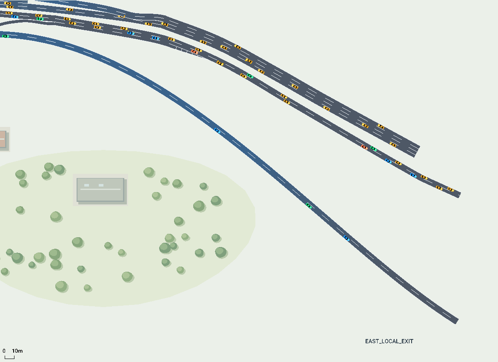
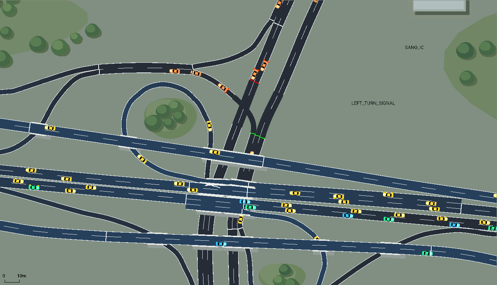
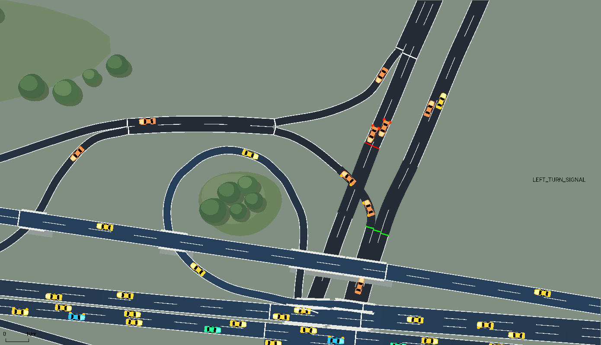

# 퇴계원·사노 IC 연결 도로

기존 퇴계원 IC 동쪽에 사노 IC를 연결했습니다. 사용자가 제공한 위성사진과 OpenStreetMap 중심선을 참고한 교육용 모델입니다. 기존 스켈레톤의 폴더, 함수 인터페이스, 학습 코드를 유지합니다.



## 현재 도로: 서쪽 엇갈림 구간과 북서쪽 연결도로 정리 (2026-11-07)

기존 2차로 본선에 1차로 램프가 합류한 뒤 **약 228m의 3차로 공통 구간**을 달립니다. 끝에서 오른쪽 차로는 `WEST_LOCAL_EXIT` 독립 출구로 빠지고, 나머지 두 차로는 본선으로 이어집니다. 본선에서 출구로 향하는 차량과 램프에서 본선으로 향하는 차량이 이 공통 구간에서 실제로 차선을 바꾸도록 경로를 구성했습니다.

북서쪽으로 올라가던 연결도로와 그쪽으로 합류하던 1차로 램프는 사용자 요청으로 제거했습니다. 관련 5개 Edge와 4개 불필요한 Node, 2개 Route를 삭제했고, 동쪽 본선 접근부는 2차로로 정렬했습니다. 동구릉로에서 금강로로 들어오는 남은 두 진입로는 지상 합류부에서 하나의 차로로 합류합니다. 기존 북행 고가와 남행 하부 도로의 입체분리는 유지합니다.

삭제한 경로의 510대/시간은 남아 있는 서행 본선 경로로 옮겼고, 새 서쪽 독립 출구에는 본선 교통량 중 360대/시간을 배정했습니다. 전체 합성 수요는 **14,420대/시간**으로 같습니다. 차선 변경을 외부 명령으로 강제하거나 충돌 검사를 끄지 않았습니다. 실제 도로와 달리 수정한 부분이므로 발표에서 교육용 설계 변경으로 구분합니다.

| Seed | 총 도착 차량 | 서쪽 공통 구간 차선 변경 | 본선→독립 출구 | 램프→본선 | 충돌 / 텔레포트 | 급제동 경고 |
|---|---:|---:|---:|---:|---|---:|
| 42 | 2,014 | 276 | 50/50 | 168/168 | 0 / 0 | 2 |
| 7 | 2,014 | 262 | 50/50 | 168/168 | 0 / 0 | 0 |
| 23 | 2,014 | 265 | 50/50 | 168/168 | 0 / 0 | 0 |

각 시드를 1,200초 실행했습니다. ‘본선→독립 출구’와 ‘램프→본선’은 해당 방향의 차선 변경을 실제로 수행하고 도착한 차량 수입니다. 유입 경로별 차량 수의 정수화로 이전 설정보다 총 투입은 1대 적지만 설정 수요는 같습니다. 종료 시 주행 중/삽입 대기 차량과 긴급 정지는 모두 0입니다. seed 42의 급제동 경고 2회는 `west_in_1`, `sb_main_0`에서 발생했으며 삭제하거나 숨기지 않았습니다.

[현재 도로의 전체 검증 기록](assets/sano/west_weave_collector_removal_validation.json). `python -m utils.validate_hv_interactions`로 HV 주행·상호작용과 새 엇갈림 구간의 차선 변경을 다시 측정할 수 있습니다. 기존 AV 제어 시험과 아래 날짜별 검증은 당시 도로 기준이며, 이번 결과는 학습된 AV 정책의 성능 평가가 아닙니다.

## 백업과 작업 브랜치

- 추가 전 도로: `662fd15d5cc789bcae25ae3563b125a0f5ab6374`.
- 이 PC의 백업 브랜치: `backup/toegyewon-ic-2026-10-30`.
- 확장 작업을 진행한 로컬 브랜치: `kyh-sano-ic`. 현재 공유 브랜치: `kyh`.
- 프로젝트 상위 `outputs/backups/`에 ZIP, 전체 Git 이력 bundle, SHA-256 검사 기록과 복원 안내를 보관했습니다. ZIP CRC, 핵심 파일 비교, bundle 검증을 통과했습니다.
- ZIP은 새 폴더에 풀고 그 안에서 `python view_road.py`로 이전 도로를 실행할 수 있습니다. ZIP 안에는 도로 소스, SUMO 생성 파일과 주변 환경이 포함됩니다.

Git 백업으로 돌아가려면 현재 변경을 커밋한 상태에서 `git switch backup/toegyewon-ic-2026-10-30`을 실행합니다. 확장본으로 복귀하려면 `git switch kyh-sano-ic`을 실행합니다. 이 두 브랜치는 현재 로컬 브랜치입니다.

## 실행

SUMO와 Python 패키지가 설치된 기존 환경에서 저장소 루트를 VS Code로 열고, CMD에서 실행합니다.

```bat
python view_road.py
```

기본 화면은 두 IC 전체 보기입니다. ▶로 재생하고 마우스 휠로 사노 IC를 확대할 수 있습니다. 기존 차량 표시 1.5배, Delay 300ms, 시뮬레이션 스텝 0.2초를 유지했습니다.

```bat
python view_road.py --nogui --seconds 1200
python view_road.py --netedit
```

실행할 때 `env/sumo/highway.*`가 재생성되므로 영구 도로 수정은 `env/road_config.py`에서 합니다.

## 추가한 도로

- 금강로 본선을 동쪽까지 연장하고 사노 IC 진출입을 연결했습니다.
- 동구릉로 남·북행, 북서쪽 루프와 남동쪽 루프를 추가했습니다.
- 본선 양옆의 연결도로와 교량, 동쪽 독립 출구, 북서쪽 외부 출구를 추가했습니다.
- 사진·지도에서 확인한 여섯 방향 전환과 남북 직진을 구현했습니다. 모든 방향으로 회전 가능한 교차로를 가정하지 않았습니다.
- 가속·감속 차로를 따로 연결해 합류·분기부의 차로 겹침을 줄였습니다.
- 사노 IC 루프의 녹지, 나무와 주변 건물도 추가했습니다. 배경은 실제 측량값이 아닌 장식입니다.

초기 사노 IC 확장 당시 외부 도로 구간은 39개에서 **74개**, 차로 연결은 72개에서 **136개**, 차량 경로는 13개에서 **23개**가 됐습니다. 현재 수정본은 **70개 도로 구간, 127개 차로 연결, 22개 경로**이며 아래 초기 확장 설명과 이후 변경 기록을 구분합니다. 기존 39개 중 35개 도로 형상은 그대로이며, 동쪽 연결에 필요한 `east_accel`, `east_out`, `east_service_out`, `west_in`의 고도 또는 구간 분할만 수정했습니다. 기존 자율주행 차량의 `north_to_west` 경로는 유지했습니다.





## 교량과 모델 가정

동구릉로 남행은 지상 0m이며, 북쪽 분기부의 북행과 서쪽 연결도로는 **5m 높이로 올라가 남행 차로 위를 통과**합니다. 사노 IC 금강로 교량은 8m, 바깥 연결도로 교량은 16m입니다. 숫자 높이·경사·이동한 합류 위치는 보기 쉽고 주행 가능한 교육용 모델을 위한 가정이며 실측값이 아닙니다. 서로 위아래로 통과하는 도로는 노드를 공유하지 않습니다.

차로 수가 지도에 없는 구간은 편도 2차로와 보조 차로를 기본으로 구성했습니다. 북쪽 고가 연결도로는 상류 4차로 분기를 자연스럽게 잇기 위해 일부 OSM 3차로 표기 구간을 2차로로 단순화했습니다. 북서쪽 연결도로의 더 먼 고속도로 접속은 범위 밖으로 두고 외부 출구로 마무리했습니다.

이전에 같은 높이의 좌회전 교차부로 만들었던 부분은 **2026-11-02 입체분리로 교체**했습니다. `sano_local_cross`와 그 신호는 제거했고, 북행 분기 `sano_nb_flyover_split`과 남행 통과 `sano_sb_underpass`는 다른 노드입니다. 아래의 신호 실험은 이전 모델의 기록이며 현재 도로에 적용되지 않습니다.

## 차량과 교통량

기존 회색·파랑·초록·보라·노랑 색의 의미는 유지합니다. 새 **주황색**은 동구릉로 남·북쪽 경계에서 들어오는 일반 차량입니다. 색은 출발 경로에 따라 고정되며 다리를 통과해도 바뀌지 않습니다. 빨간 `ego_demo` 역시 일반 SUMO 제어기를 사용하는 확인용 차량입니다.

기존 금강로 직진 교통량 일부를 새 진출 경로로 나눴고, 동구릉로 경계 유입을 추가했습니다. 전체 합성 수요는 14,420대/시간을 0~500초에 투입합니다. 실제 교통량 조사값이나 학습된 정책의 성능 결과는 아닙니다.

## HV 혼합과 상호작용 검증 (2026-11-02 당시)

일반 차량의 모델을 수업 코드의 비율로 복원했습니다. 모든 유입 경로에 같은 `carDist`를 적용합니다. 모델별 전용 도로나 차로는 없으며 차체 색은 기존 경로 색입니다.

| 모델 | 설정 확률 | tau (s) | 최소 간격 (m) | speedDev |
|---|---:|---:|---:|---:|
| Krauss | 35% | 1.0 | 2.5 | 0.15 |
| IDM | 30% | 1.2 | 2.0 | 0.10 |
| EIDM | 20% | 1.1 | 2.0 | 0.10 |
| ACC | 15% | 1.5 | 2.0 | 0.05 |

가감속·차간시간·속도 편차는 수업 기본값을 사용합니다. 최고속도 상한은 IC용 33.33m/s이고 실제 도로별 제한속도는 별도로 적용됩니다. 확률 표본이므로 실제 투입 수는 매번 비율과 정확히 일치하지 않습니다. 별도 모델 파라미터는 SUMO 1.27.1 기본값입니다. 0.2초 스텝은 [EIDM의 문서상 범위 0.05~0.5초](https://sumo.dlr.de/docs/Car-Following-Models/EIDM.html)에 속합니다. ACC의 기본 충돌 회피 기능은 [차량 모델 자체의 구성](https://sumo.dlr.de/docs/Car-Following-Models/ACC.html)으로 유지합니다.

`keep_lane=False`로 일반 차량의 경로 선택·협조·속도 이득을 위한 차선 변경을 허용합니다. 수요는 기존 14,420대/시간, 유입 0~500초, 도로와 연결 관계도 그대로입니다. 차량 수나 충돌 검사를 줄여 통과시키지 않았습니다.

SUMO 1.27.1에서 seed 42·7·23을 각각 1,200초 실행했습니다. 매 실행 일반 차량 2,014대와 일반 SUMO 제어 시연차 1대가 모두 도착했습니다.

| Seed | Krauss / IDM / EIDM / ACC | HV 차선 변경 | 주변 차량 30m 이내 차선 변경 | 3초 이상 근접 추종한 HV | 충돌 / 텔레포트 | 급제동 경고 |
|---|---|---:|---:|---:|---|---:|
| 42 | 665 / 636 / 404 / 309 | 2,030 | 997 | 1,294 | 0 / 0 | 3 |
| 7 | 724 / 588 / 398 / 304 | 2,022 | 1,030 | 1,289 | 0 / 0 | 3 |
| 23 | 728 / 613 / 389 / 284 | 1,993 | 991 | 1,265 | 0 / 0 | 3 |

- 차선 변경은 [SUMO lanechange-output](https://sumo.dlr.de/docs/Simulation/Output/Lanechange.html)의 실제 `change` 이벤트입니다. 예를 들어 seed 42는 협조적 변경 63회, 퇴계원 `weave` 구간 변경 280회를 기록했습니다.
- 근접 추종은 자기 속도 ≥2m/s, 실제 연결된 차로의 HV 선행차와 `차간거리/자기속도 ≤2초`인 표본입니다. 1초 간격에서 같은 선행차를 4번 연속 관측해야 3초 이상으로 셉니다. XY 좌표가 겹치는 다리 위아래 차량은 이웃으로 합산하지 않습니다.
- seed 42에서 1,006대가 이 추종 조건과 동시에 0.5m/s² 이상 감속했습니다. 이것은 관측된 동시 발생 지표이며 모든 감속의 원인이 앞차라는 인과 검증은 아닙니다.
- 급제동 3회는 각 실행에서 ACC 차량에 발생했습니다. seed 42의 로그와 차선 변경 기록에서는 느린 차량의 끼어들기 직후 발생했습니다. 경고를 숨기거나 차량을 제거해 숫자를 줄이지 않았으며, 승차감·안전성 분석 시 검토할 항목입니다. 네트워크 연결 정상 여부와 급제동 검토 여부는 별도로 기록합니다.

[HV 검증 결과](assets/sano/hv_interaction_validation.json)는 완주·충돌뿐 아니라 모델별 수, 차선 변경 이유, 구간별 추종 표본을 포함합니다. 원시 로그/FCD는 검증 명령의 출력 폴더에 남습니다. 재실행:

```bat
python -m utils.validate_hv_interactions
```

## AV 제어와 평가의 구분

추가 규칙이 정책의 위험한 차선 변경을 대신 차단하지 않도록 `env/mdp_config.py`의 `ACTION["lane_change_safety"]["enabled"] = False`로 설정했습니다. 기존 `SumoHighwayEnv`, 학습·평가 함수와 31차원 관측 인터페이스는 변경하지 않았습니다. 원래 코드의 `speedMode=0`, `laneChangeMode=0`과 유효 차로 범위 검사, 충돌 검출·감점은 유지합니다. 앞으로 학습/평가를 시작하면 이 설정을 함께 사용합니다.

검증은 두 종류로 구분했습니다.

1. **위험 명령 시험:** 별도의 무교통 시험 파일에서 옆 차로에 차를 배치하고 겹치는 차선 변경을 지시했습니다. 이 시험용 상대차만 차선을 고정했으며 실제 HV 교통에는 적용하지 않았습니다. 차단 규칙 ON이면 명령 차단, OFF이면 실제 충돌 검출·보상 -5·에피소드 종료를 확인했습니다. SUMO의 `collision.action=remove`로 제거되면 `arrived`도 참일 수 있지만 기존 보상과 평가기는 `collided`를 우선해 실패로 계산합니다.
2. **주변 HV 확인:** 실제 교통 설정에서 학습 환경을 열고 60초간 고정 행동 `[0,0]`(속도·차로 유지)을 실행했습니다. 시작 시 HV 91~101대, AV의 연결 차로/인접 차로 40m 이내에서 서로 다른 HV 6~8대를 만났습니다. 300스텝 중 296~300스텝에 주변 HV가 있었고 관측 벡터도 정상입니다. 학습된 정책의 주행 성능 시험이 아닙니다.

[AV 제어 검증 결과](assets/sano/av_control_validation.json). 재실행:

```bat
python -m utils.check_av_control
```

현재 학습용 `r0`는 `north_to_west`이며 퇴계원 합류·엇갈림을 통과합니다. 사노 IC까지 포함하는 AV 경로 검증은 별도입니다. GUI의 빨간 `ego_demo`도 학습 정책이 아닙니다.

**현재 확인한 범위는 혼합 HV의 실제 상호작용과 AV 제어 연결입니다.** 실제 학습 정책을 넣은 뒤 동일한 교통 수요에서 추종 시간, 합류·차선 변경, 충돌률, 완주율을 여러 시드로 평가해야 합니다. 배경 차량의 충돌 0회를 AV 학습 성공으로 쓰면 안 됩니다. 차단 규칙을 켜서 진행한 이전 정책 결과도 현재 설정에서 다시 평가해야 합니다. 상호작용의 교육적 충분성에 보편적인 숫자 기준이 있는 것은 아니므로 장면 영상과 위 지표를 함께 제시합니다.

## 교량 사이 차로 정리 (2026-10-30)

동구릉로의 양방향 차로 간격을 확보하고 남동쪽 루프를 북행 **오른쪽 보조 차로**에 연결했습니다. 북쪽 좌회전은 별도 왼쪽 차로에서 처리합니다. 위쪽 합류 후 분기까지의 공통 구간은 약 11m에서 64m로 늘려 급하게 갈라지는 형상을 다듬었습니다.

교량 사이 검사 구간(y=140~199m, 유효 단면 59개)에서 양방향 포장 경계 간 최소 간격은 7.335m입니다. 도로 간격과 교차부 영역은 보기 쉬운 교육용 모델을 위한 조정값입니다. 차량 경로·색·유입량은 그대로 유지했습니다.

[차로 정리 후 검증](assets/sano/corridor_validation.json): seed 42, 7, 23에서 각각 2,015대 전원 도착, 충돌·긴급 정지·긴급 제동·텔레포트 0회. 아래의 초기 확장 검증과 구분해 기록했습니다.

## 동쪽 연결도로 독립 출구 (2026-10-30)

남쪽 고가 연결도로를 타는 차량은 이제 금강로에 다시 합류하지 않고 **별도 2차로 출구 `EAST_LOCAL_EXIT`**로 빠져나갑니다. 기존 `sano_service_merge`를 `sano_service_out`으로 바꾸고 새로운 끝점 `sano_service_boundary`에 연결했습니다. 본선 출구는 합류 차량을 위한 추가 차로를 없애고 연속적인 2차로로 정렬했습니다.

`north_to_local`, `south_to_local` 두 경로가 독립 출구에서 종료합니다. 나머지 경로와 차량 수·색은 그대로입니다. 이 독립 출구는 사용자 요청에 따른 설계이며 해당 구간의 실제 지도상 합류 형상과는 다릅니다.

[독립 출구 검증](assets/sano/separate_exit_validation.json): 세 가지 seed에서 각각 2,015대 전원 도착, 독립 출구 차량 56대 전원 해당 출구로 도착, 충돌·긴급 정지·긴급 제동·텔레포트 0회. 생성된 SUMO 도로망에서도 독립 출구에서 본선으로 가는 연결이 없음을 확인했습니다.

## X자 교차부 입체분리 (2026-11-02)

아래쪽에서 올라와 서쪽으로 빠지는 연결도로가 남행 도로를 **5m 위로 통과**하도록 분리했습니다. 단순한 색상 변경이 아니라 교차점의 연결 노드를 분리하고 실제 도로 형상에 z 좌표를 넣었습니다. 상부 포장·난간·그림자는 자동 교량 표시로 생성합니다.

북행 접근부는 0→1→5m로 완만하게 올라갑니다. 상부 직진은 이후 다시 지상으로 내려가고, 서쪽 연결도로는 남행 차로를 지난 뒤 내려와 각 진입로 전용 차로로 이어집니다. 서쪽 합류 위치를 옮겨 하강 길이를 확보하고, 합류 후 차로 변경 구간은 70m로 구성했습니다. 수정한 도로 중심선의 최대 경사는 약 8.48%이며 모델용 설계값입니다.

동일한 23개 경로와 합성 교통량으로 seed 42, 7, 23에서 각각 1,200초 검증했습니다.

- 각 실행 2,015대 전원 도착; 충돌·긴급 정지·긴급 제동·텔레포트 0회.
- 해당 서쪽 진출 경로의 평균·최대 정지 대기시간은 세 seed 모두 0초.
- 문제 교차부와 연결도로를 포함한 감시 구간에서 정지 차량 표본 0개(0.2초 간격, 0.1m/s 미만).
- 새 교량과 하부 두 차로의 중심선 고도 차이는 각각 5m. 수정 도로와 관련된 비연결 차로 교차 40곳도 모두 5m 이상.
- 생성 도로망의 신호 제어기 0개, 기존 X자 공유 노드 없음. 136개 차로 연결과 모든 차량 경로의 연속성 확인.

[입체분리 검증 기록](assets/sano/grade_separation_validation.json). 이는 일반 차량 모델 검증이며 학습한 AV 성능 평가가 아닙니다. 기존 AV 경로는 유지했으며 신호·교차부 학습을 수행한 것은 아닙니다.

## 이전 실험: 신호를 이용한 좌회전 대기 개선 (2026-11-02)

이 절은 입체분리 전의 비교 기록입니다. 현재 신호 프로그램과 평면 교차부는 사용하지 않습니다.

`sano_local_cross`에 보호 좌회전 신호를 추가했습니다. 맞은편 직진 24초 → 황색 5초 → 교차부 비우기 3초 → 좌회전 12초 → 황색 5초 → 비우기 3초로, 총 **52초** 주기입니다. 좌회전과 충돌하지 않는 북행 직진 두 차로는 계속 통과할 수 있습니다. 신호 상태는 SUMO 정지선의 색 막대로 표시합니다.

`env/road_config.py`의 `ROAD["traffic_lights"]`가 원본이며, 기존 `python view_road.py` 실행 시 `highway.tll.xml`과 신호가 포함된 도로망을 생성합니다. 차로 연결의 신호 번호도 명시해 자동 번호 변경으로 신호가 뒤바뀌지 않도록 했습니다. [SUMO 신호 문서](https://sumo.dlr.de/docs/Simulation/Traffic_Lights.html), [신호 파일 형식](https://sumo.dlr.de/docs/Networks/PlainXML.html#traffic-light-program-definition)을 사용했습니다.

동일한 경로·교통량·차량 설정으로 변경 전후를 seed 42, 7, 23에서 각각 1,200초 비교했습니다. 아래 값은 차량 경로 전체의 정지 대기시간이며, 화면 재생 시간과 다릅니다.

| 항목 (seed 42) | 변경 전 | 변경 후 |
|---|---:|---:|
| 문제 좌회전 경로 평균 대기 | 134.57초 | 13.72초 |
| 문제 좌회전 경로 최대 대기 | 247.4초 | 56.2초 |
| 맞은편 남행 직진 평균 대기 | 0초 | 5.31초 |
| 전체 차량 누적 대기 | 3374.8초 | 759.8초 |

변경 후 세 seed 모두 2,015대 전원 도착, 충돌·긴급 정지·긴급 제동·텔레포트 0회였습니다. 다른 seed의 좌회전 평균 대기는 12.69~13.84초입니다. 고가도로 연결과 독립 출구는 그대로이며, 신호 대기는 여전히 발생합니다. 실제 교통량·신호 자료로 보정하거나 RL 정책을 재학습한 결과는 아닙니다. [전체 비교 기록](assets/sano/signal_validation.json)



## 합류 차로 분리 기록 (2026-11-02)

아래 검증은 입체분리 전 형상 기준입니다. 이후 입체분리로 합류 위치를 옮겼고, 북서쪽 출구 삭제 후에는 남은 금강로 진입로를 1차로로 합쳤습니다.

보호 좌회전 다음의 `sano_local_merge`에서 두 진입로가 모두 공통 구간의 두 차로로 직접 들어가도록 연결되어 있었습니다. 이 교차 연결 때문에 아래쪽 좌회전 진입로가 위쪽 진입 차량 전체에 양보하면서 추가 정지가 발생했습니다.

위쪽 `sano_sb_to_west`는 `sano_west_ramp_split`의 오른쪽 차로 0, 아래쪽 `sano_nb_to_west`는 왼쪽 차로 1에 각각 연결했습니다. 중복 교차 연결 두 개를 제거했고, 목적지에 필요한 차로 변경은 약 63m의 공통 구간에서 수행합니다. 모든 23개 경로를 유지하며 외부 도로 형상·차로 수·교통량·52초 신호 주기는 변경하지 않았습니다. 기존 138개 차로 연결은 136개가 됐습니다. [SUMO 차로 연결 문서](https://sumo.dlr.de/docs/Networks/PlainXML.html#connection-descriptions)의 연결 방식에 맞춰 생성했습니다.

seed 42, 7, 23에서 각각 1,200초 비교한 결과, 변경 전 아래쪽 합류 접근로의 차량별 최대 누적 정지는 각각 **30.6초, 28.6초, 6.6초**였습니다. 변경 후 두 접근로·공통 구간·두 출구 연결도로에서 측정한 정지는 **세 seed 모두 0초**였습니다(0.2초 간격, 속도 0.1m/s 미만). 각 실행의 2,015대 전원 도착, 충돌·긴급 정지·긴급 제동·텔레포트 0회였습니다. 신호 앞 대기는 계속 존재하며, 다른 교통 수요에서도 무정지를 보장하는 결과는 아닙니다.

[합류 개선 검증 기록](assets/sano/merge_validation.json)



## 초기 확장 검증

[검증 기록](assets/sano/validation.json)에 실행 결과와 보존한 파일 목록을 기록했습니다.

- seed 42, 7, 23에서 각 1,200초 실행: **2,015대 전원 도착**.
- 세 실행 모두 충돌, 긴급 정지, 긴급 제동, 텔레포트 0회. 종료 시 주행·삽입 대기 차량 0대.
- 모든 명시적 차로 연결이 생성 결과에 존재하고, 23개 경로 모두 연속적으로 연결됨.
- 서로 연결하지 않은 도로 중심선 교차는 모두 높이 차이 4m 이상.
- 팀의 기존 `train.REWARD`로 Gym reset + 25스텝 통과: 관측 31차원, 행동 2차원.
- `train.py`, `train_bc.py`, `collect_pomdp_data.py`, `test.py`, `view_road.py`, `algorithms/`, `utils/`, `env/sumo_env.py`의 기존 Python 파일은 백업 커밋과 동일.

도로 관련 Python 변경은 `env/road_config.py`, `env/road_builder.py`, `env/mdp_config.py` 세 파일입니다. 전체 정책 재학습이나 실제 교통량에 대한 보정은 수행하지 않았습니다.

## 출처

© OpenStreetMap contributors, [ODbL 출처와 이용 안내](https://www.openstreetmap.org/copyright). 사용자가 제공한 네이버 위성사진은 형상 대조용으로 참고했습니다. [사노 IC 지도](https://www.openstreetmap.org/#map=17/37.6415/127.1402)와 [구간별 출처·가정](../project_materials/sano_geometry_sources.json)을 함께 보관합니다. 기존 퇴계원 IC의 출처는 [이전 자료](../project_materials/toegyewon_geometry_sources.json)에 있습니다.
