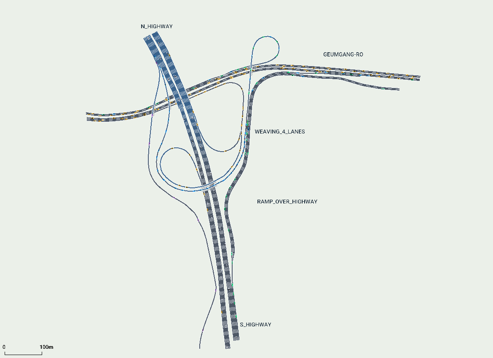
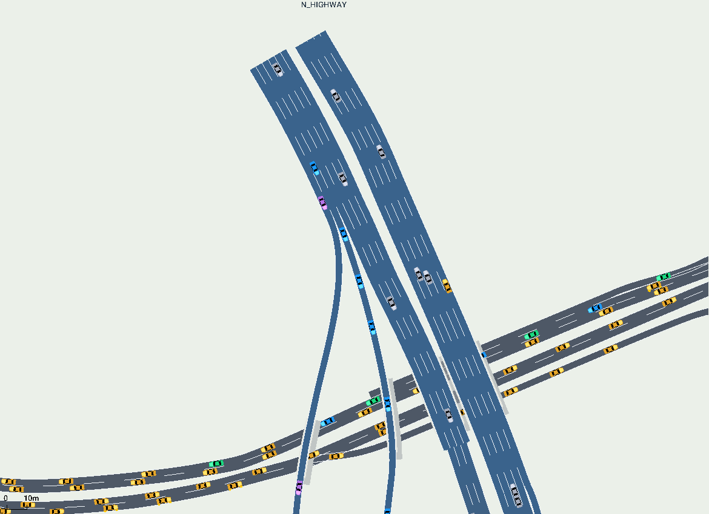
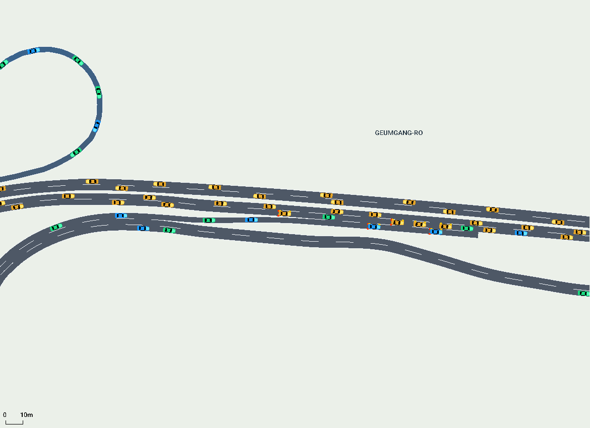
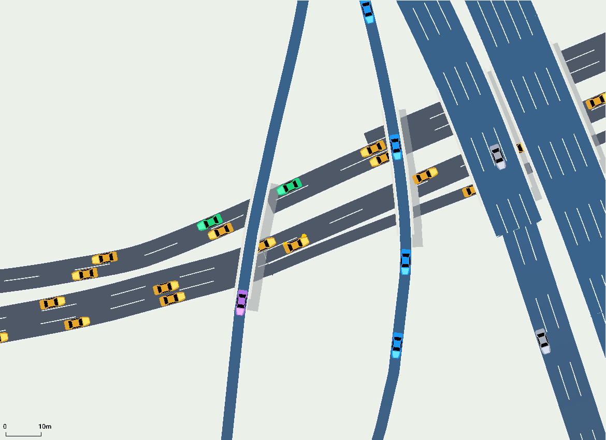

# 퇴계원 IC 도로 구현 — kyh

교수님 스켈레톤의 파일·폴더와 함수 인터페이스를 유지하면서 퇴계원 IC 교육용 도로를 연결했습니다. 사용자 제공 위성사진과 OpenStreetMap 중심선을 참고했으며, 가독성과 주행을 위해 합류·분기 형상을 단순화했습니다. 정밀 측량 기반 디지털 트윈은 아닙니다.



## 실행

SUMO 1.27.1과 저장소의 Python 패키지를 설치한 뒤 이 저장소 루트의 CMD에서 실행합니다.

```bat
python -m pip install -r requirements.txt
python view_road.py
```

SUMO의 ▶를 누르면 차량이 움직입니다. 전체 도로 보기, 차량 표시 1.5배, Delay 300ms, 시뮬레이션 스텝 0.2초를 사용합니다.

```bat
python view_road.py --nogui --seconds 1200
python view_road.py --netedit
```

`view_road.py`는 실행할 때 `env/sumo/highway.*`를 다시 생성합니다. 도로의 영구 수정은 `env/road_config.py` 아래쪽의 IC 설정에서 진행하세요.

## 구현 범위

- 외부 Edge 39개, 명시적 차로 연결 72개, 차량 경로 13개.
- 고속도로가 금강로 위를 통과하고, 아래쪽 두 램프 교량은 고속도로 위를 통과합니다. 층이 다른 도로는 평면상 교차해도 서로 연결되지 않습니다.
- 위쪽 남행 진입부는 직진 4차로와 진출 2차로입니다. 파란 차량과 보라 차량은 같은 본선에서 들어와 각각 안쪽·바깥쪽 진출로로 갈라집니다.
- 아래쪽 북행 진입부는 직진 4차로와 진출 1차로입니다. 분리된 진출로는 약 90m 후 3차로로 넓어집니다.
- 오른쪽 공통 구간은 4차로이며, 동쪽 램프 3차로와 고가 루프 1차로로 분기합니다.
- 금강로 동쪽에서는 합류 차로와 별도 2차로 출구의 겹침을 제거했습니다.
- 다리 아래 서쪽 진입부는 직진 2차로와 전용 진출 1차로를 정렬했습니다.
- 왼쪽 외곽 램프의 남쪽 끝은 본선에 다시 합류하지 않는 별도 출구입니다.

위 차로 구성에는 사용자 요청에 따른 단순화가 포함됩니다. 합성 교통량은 총 12,600대/시간을 0~500초 동안 투입합니다. 실제 교통량 조사값은 아닙니다.







## 차량 색

색은 경로별로 고정되어 있으며 도로를 바꿔 타도 변하지 않습니다.

| 색 | 의미 |
|---|---|
| 회색 | 고속도로 직진 |
| 파랑 | 위쪽 남행 본선에서 안쪽 IC 진출로로 이동 |
| 보라 | 위쪽 남행 본선에서 바깥 진출로로 이동 |
| 초록 | 아래쪽 북행 본선에서 IC로 진출 |
| 노랑 | 금강로에서 직진하거나 고속도로로 진입 |
| 빨강 | 일반 SUMO 제어기를 쓰는 주행 확인용 `ego_demo` |

빨간 시연차는 학습된 자율주행 정책이 아닙니다. Gym 환경이 생성하는 `ego`와 별개입니다.

## 코드와 팀 작업 보존

| 변경 파일 | 내용 |
|---|---|
| `env/road_config.py` | 하단 IC 노드·도로·차로 연결·경로·교통량 설정 |
| `env/road_builder.py` | IC 생성과 교량·차선 표시; 기존 직선 도로 생성도 유지 |
| `env/mdp_config.py` | 하단 화면·시간·warmup 설정 |
| `view_road.py` | Windows 콘솔 출력의 `≈`를 `~`로 변경 |

`build(road, ego, traffic, out_dir)`와 `ROAD/EGO/TRAFFIC`, 기존 Gym 인터페이스를 유지합니다. 팀의 `train.py`, `algorithms/`, `utils/`, `env/sumo_env.py`, 샘플 데이터, 의존성 설정과 Git ignore 규칙은 변경하지 않았습니다. 팀 웹페이지와 Canva 링크도 보존했습니다.

`env/sumo/`는 기존 팀 저장소의 추적 방식에 맞춰 최신 생성 결과를 포함합니다. 캐시, 실행 로그, 학습 모델과 신규 대용량 데이터는 커밋에 포함하지 않습니다.

## 검증과 한계

동일한 도로 소스의 seed 42, 7, 23 검사에서 각 1,759대가 도착했고 충돌·긴급 정지·긴급 제동·텔레포트가 없었습니다. 도로 생성기 경고도 없습니다.

팀 `kyh` 코드에 통합한 뒤 추가로 다음을 확인했습니다.

- `python view_road.py --nogui --seconds 1200`: 1,759대 삽입, 종료 시 주행·삽입 대기 차량 0.
- 팀의 `train.REWARD`를 사용한 Gym reset + 25스텝: 관측 31차원, 행동 2차원, 유한한 관측값.
- 도로 관련 Python 파일 네 개만 변경되며, 팀의 나머지 Python 파일은 기준 브랜치와 동일.
- 원본 함수 인자·폴더 구조를 보존하고, 기존 경로가 서로 연결되는 것을 확인.

[도로 검증 기록](assets/toegyewon/road_validation_report.json)과 [팀 통합 검증 기록](assets/toegyewon/integration_validation.json)을 구분해 보관합니다. 전체 PPO/BC 학습이나 정책 성능 평가는 수행하지 않았습니다.

최근 합류 정리 이후에는 같은 합성 수요에서도 심한 정체가 거의 발생하지 않습니다. 혼잡을 연구하려면 출발 수요·진출 비율·차로 변경 조건 등을 별도로 설계하고 평가해야 합니다.

기존 `data/dataset.npz`는 이 IC에서 새로 수집한 시범 데이터가 아닙니다. 학습 전에 시범 데이터 적합성과 다중 Edge 환경의 관측·보상·종료 조건을 검토해야 합니다. 원본 단일 Edge 프리필은 비활성화했고 실제 흐름으로 100스텝 warmup합니다. `flow_end` 및 에피소드 길이도 실험 목적에 맞춰 조정하세요.

## 좌표 출처와 가정

도로 중심선은 동경 127.132°, 북위 37.640°를 기준으로 미터 좌표로 변환했습니다. 물리 차로 폭 3.5m, 교량 층 높이 8m, 본선·램프 속도 및 일부 보조 차로는 모델 가정입니다. 상세 출처와 형상 조정은 [좌표 출처 JSON](../project_materials/toegyewon_geometry_sources.json)에 기록했습니다.

좌표·도로 데이터: [OpenStreetMap contributors](https://www.openstreetmap.org/#map=17/37.640/127.132), [ODbL 및 저작자 표시](https://www.openstreetmap.org/copyright). OSM에서 유래한 도로 형상 데이터는 ODbL 1.0에 따릅니다. 교수님 코드의 라이선스를 변경하는 의미는 아닙니다.
