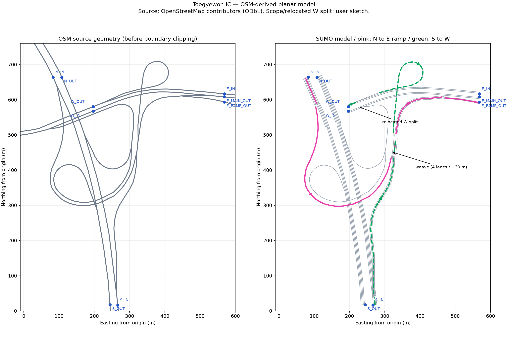
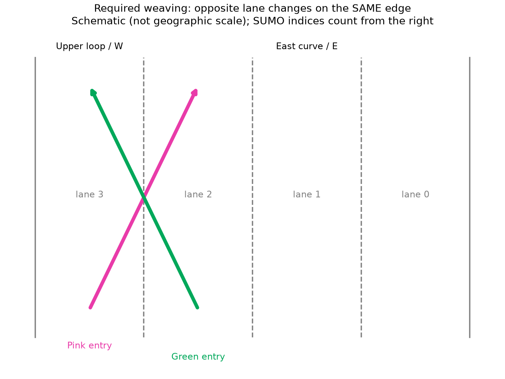

# 퇴계원IC — OSM 기반 평면 모델

**POMDP 수집(2026-11-02):** [19개 필수 항목·43차원 schema·실제 데이터·재현성·중단 복구·CLI](data_collection.md). 관측 전용 휴리스틱으로 기본 조건 1,888개 전이를 수집했으며, 별도 혼잡 시간 초과 사례도 보존했습니다. 학습된 정책 성능을 의미하지 않습니다.

**버스·AV 통합(2026-11-02):** [혼합 교통 실행·기존 AV 분석·새 인터페이스·실측 결과](bus_av.md)를 참고하세요. 기본 GUI 명령은 승용차 조건을 유지하며 `--bus-ratio 0.1 --av sumo`로 혼합 환경을 선택합니다. 현재 AV 완주는 SUMO 기본 모델 결과이고 학습된 PPO 성능은 미검증입니다. 아래 최초 구현 당시의 AV 미연결 설명은 이 문서로 갱신됩니다.

**교통량 개선(2026-11-02):** 현재 기본값은 보통 교통량 + weave 비중 강화입니다. [설정·12개 Route 분류·증가 전후 실측 결과](traffic.md)를 참고하세요. 아래 7절의 74대 결과와 `validation.json`은 최초 구현의 기준 기록입니다.

개인 Fork의 `origin/ljj`와 동일한 `be62cc79fcc248de1f307bf5e59a97aff5bb3df0`에서 시작한 독립 시나리오입니다. 기존 `env/road_builder.py`, 고속도로 XML, PPO/BC 및 데이터 수집 코드는 변경하지 않았습니다.

## 1. 출처와 해석

- 사용자가 제공한 `퇴계원 IC 모델링 범위 및 주요 상호작용 표시.pdf`: 파란 범위, 네 OPEN, 두 차량 경로와 주을천교 오른쪽 평면화의 기준.
- [OpenStreetMap](https://www.openstreetmap.org/#map=18/37.64013/127.13453): 실제 도로 node 좌표, way 순서, 일방통행, 차로 수와 속도 태그. © OpenStreetMap contributors, ODbL 1.0.
- [수집 출처·해시](../../scenarios/toegyewon/source/provenance.json): 2026-10-31 수집. 원본을 저장해 오프라인 재생성 가능.
- [SUMO OSM 가져오기](https://sumo.dlr.de/docs/Networks/Import/OpenStreetMap.html), [PlainXML 및 차로 변경 제한](https://sumo.dlr.de/docs/Networks/PlainXML.html), [차로 변경 기록](https://sumo.dlr.de/docs/Simulation/Output/Lanechange.html).

Google Maps에 추가 HTTP 요청을 하지 않았습니다. 사용자 지도와 정상 접근 가능한 OSM을 사용했습니다. OSM 후속 조회 일부가 오류/시간 초과여서 북쪽 진입 way만 공식 OSM API에서 보완했습니다. 접근 제한 우회는 사용하지 않았습니다.

OSM 전체를 자동 변환한 후 불필요한 연결을 추측해 제거하는 방식 대신, 선택한 OSM 선분 → 명시적 node/edge/lane connection XML → `netconvert`를 사용했습니다. 기존 프로젝트의 XML 생성·netconvert 실행 방식을 따른 별도 모듈입니다.

## 2. 범위와 OPEN

네 위치에 진입 4개·진출 5개를 배치했습니다. **동쪽에는 서행 진입 1개와 서로 다른 동행 진출 2개**가 있습니다. OSM의 `781184662`, `169929503`, `169728835`를 대조한 결과입니다.

| 위치 | 진입 | 진출 | 절단 기준 WGS84 |
|---|---|---|---|
| 좌측 상단 N | `N_in` | `N_out` | 위도 37.6420 |
| 하단 S | `S_in` | `S_out` | 위도 37.6362 |
| 좌측 중앙 W | `W_in` | `W_out` | 경도 127.1331 |
| 우측 E | `E_in` | `E_main_out`, `E_ramp_out` | 경도 127.1373 |

경계는 손필기의 OPEN 위치를 OSM 도로와 대조해 정한 **근사 절단 위치**입니다. 설계 이미지에 측량 좌표가 없어 파란 선 전체를 픽셀 단위로 지리 보정했다고 주장하지 않습니다. 파란 선은 도로로 생성하지 않았고 범위 밖의 서쪽 램프·상단 우회로·일반 도로는 제외했습니다. 경계 좌표는 `config.json`에서 조절할 수 있습니다.

좌표는 WGS84 → UTM 52N(EPSG:32652)으로 변환하고 `(127.131, 37.636)`의 투영 좌표를 빼서 미터 단위로 사용합니다. 모든 node와 lane 높이는 0입니다. 공간상 교차해도 OSM의 접속 지점이 아닌 곳에 노드나 차로 연결을 만들지 않았습니다.

## 3. 연결 구조와 설계상 변경

- N 진입에서 남행 본선과 아래쪽 곡선 램프로 분기합니다.
- S 진입에서 북행 본선과 오른쪽 북상 램프로 분기합니다.
- 아래쪽 곡선 램프와 북상 램프가 `WEAVE_IN`에서 합류합니다.
- `WEAVE_OUT`에서 상단 루프와 동쪽 곡선 도로로 갈라집니다.
- 상단 루프는 서행 금강로와 합류하고, 동쪽 곡선은 별도 E 진출 및 금강로 합류로 갈라집니다.
- W 진입에서는 동행 금강로와 남쪽 연결로가 갈라지고, 남쪽 연결로에서 남행·북행 본선으로 각각 이동할 수 있습니다.

**주을천교 오른쪽의 명시적 설계 변경:** 실제 OSM의 W→남쪽 분기는 경계 서쪽 `1810879869`에 있습니다. 손필기처럼 교량 오른쪽에서 분기하도록 분기를 경도 `127.1334319`의 기존 동행 금강로 위로 옮기고, 기존 램프 node `1812112835` 이후의 곡선을 이어 썼습니다. 새 목적지 연결을 추가한 것은 아니지만 분기 위치·앞부분 길이는 실제 OSM과 다릅니다. 이 변경은 `west_turn`의 manifest에도 표시됩니다.



이 그림은 데이터에서 그린 정적 비교 도면이며 SUMO-GUI 캡처가 아닙니다. 왼쪽은 사용한 OSM way의 원형, 오른쪽은 범위 절단·분기 이동 후의 SUMO 차로 및 내부 연결입니다.

## 4. 엇갈림

공유 edge는 **`weave` 하나**입니다. 별도의 분홍 도로·초록 도로를 생성하지 않았습니다.

- OSM way `170059994`: 일방통행·4차로, 원본 선분 길이 **33.15 m**.
- SUMO의 junction 구간 절단 후 edge 길이 **30.16 m**. 임의로 길게 늘리지 않았습니다.
- 차로 index는 진행 방향의 오른쪽부터 0, 1, 2, 3입니다.
- 분홍색: `N_in → pink_approach → weave(3) → east_curve(0~2) → E_ramp_out`.
- 초록색: `S_in → green_approach(2) → weave(2) → upper_loop(3에서만 연결) → W_out`.

분홍 차량은 오른쪽, 초록 차량은 왼쪽으로 적어도 한 번 차로를 바꿔야 목적지로 갈 수 있습니다. 합류·분기의 **세부 차로별 연결은 OSM의 1+3→4→3+1 차로 수와 손필기 경로에 맞춘 모델링 가정**이며, 현장 노면 화살표까지 확인한 값은 아닙니다.



초기 배치 차로와 출발 시각만 정합니다. `changeLane`, `setSpeed`, `moveTo`, route 변경 등 강제 제어는 없습니다. SUMO 기본 Krauss 차량추종·LC2013 차로변경을 사용합니다. 비교를 위해 `sigma=0`, `speedFactor=1`로 설정했습니다. 실제 운전자의 다양성을 검증한 모델은 아닙니다.

## 5. 코드와 설정

| 파일 | 역할 |
|---|---|
| `toegyewon.py` | build/run/gui/validate/plot 공통 CLI |
| `scenarios/toegyewon/network.py` | OSM 선택·좌표 변환·경계 절단·차로 연결·수요·SUMO 설정 생성 |
| `scenarios/toegyewon/config.json` | OPEN 절단, 가정 속도/차로, 차로변경 금지 구간, 출발 시각, 교통량, seed |
| `scenarios/toegyewon/validate.py` | 실제 TraCI 주행·전체 경로·차로변경·상호작용 검증 |
| `scenarios/toegyewon/plot.py` | OSM 비교도와 차로 연결 개념도 |
| `scenarios/toegyewon/source/` | 재현 가능한 원자료와 출처 |
| `docs/toegyewon/` | 설명, 실제 검증 결과와 비교 그림 |

현재 기본 HV는 `traffic.profile=medium`, `traffic.weave_factor=2`로 174대에 두 색상 차량을 더한 176대입니다. `--traffic low|medium|high`, `--weave-factor`, `--demand-scale`과 `traffic.route_weights`로 수요를 조절합니다. `traffic.end`는 예정 투입 기간입니다. 최초 구현의 12개 경로 각각 30초 간격/총 74대는 `--traffic low --weave-factor 1`로 재현할 수 있습니다. 실제 관측 교통량이 아닌 검증용 수요이며 자세한 계산과 검증 방법은 [교통량 안내](traffic.md)에 있습니다.

## 6. 실행 방법

저장소 루트에서 Python 3.10 이상, SUMO/TraCI/sumolib 1.27.1을 사용합니다. 이 환경은 Python 3.12.14입니다.

```bash
# 최초 설치 또는 다른 팀원 PC에서
python -m venv .venv
source .venv/bin/activate
python -m pip install -r requirements.txt -r scenarios/toegyewon/requirements.txt
# 별도 SUMO가 없다면 공식 Python 배포 실행 파일 설치
python -m pip install eclipse-sumo==1.27.1

python toegyewon.py build
python toegyewon.py run
python toegyewon.py validate
python toegyewon.py compare
python toegyewon.py plot
python toegyewon.py gui
```

Windows에서는 가상환경 활성화에 `.venv\Scripts\activate`를 사용합니다. 기존 SUMO 설치를 쓰는 경우 `SUMO_HOME` 및 PATH를 설정합니다. 공식 Python SUMO 패키지 설치 시 새 모듈이 `SUMO_HOME`을 감지합니다.

기본 생성 위치는 `scenarios/toegyewon/build/`입니다. `--output 다른폴더`, `--config 다른설정.json`을 사용할 수 있습니다. 생성물은 Git에서 제외되어 자동 재생성이 기준입니다.

SUMO-GUI에서 직접 `build/toegyewon.sumocfg`를 열어도 됩니다. 두 색상 차량만 보려면 `validate`가 생성한 **`build/pair.sumocfg`**를 열고 재생하세요. 기본 시나리오와 pair에서 분홍 출발 0초, 초록 출발 17.4초로 약 57.2초에 엇갈림 구간에 함께 도달합니다. 범위/속도 변경 시 동시 도달 시각도 달라지며 `validate`는 단독 주행 시간을 이용해 pair 출발 시각을 다시 계산합니다.

`validate`의 `.trajectory.csv`, `.lanechanges.xml`, `.trips.xml`, `.collisions.xml`, `.errors.log`, `.result.json`은 build에 남습니다. 검증 실패는 0이 아닌 종료 코드로 보고됩니다. 검증을 시작하면 이전 `validation.json`을 지워 오래된 성공 결과를 재사용하지 않습니다.

## 7. 실제 검증 결과

[전체 결과 JSON](validation.json), [두 차량 차로변경 원본](pair.lanechanges.xml), [두 차량 주행 기록](pair.trajectory.csv), [차량 도착 기록](pair.trips.xml)을 참고하세요. SUMO 출력 XML 헤더에 실행 환경의 로컬 경로가 포함될 수 있습니다.

| 검증 | 결과 |
|---|---|
| 네트워크 생성 | 성공: 외부 edge 25개, 명시적 차로 연결 60개 |
| OSM 곡선·진행방향 | 선택 way의 진행 방향 유지, W 분기 위치는 위의 설계 변경 적용 |
| 의도하지 않은 연결 | 생성 네트워크의 연결을 선언한 전체 연결 집합과 비교해 누락·추가 없음 |
| 높이 | 외부 차로 z=0 검사 통과 |
| OPEN별 경로 | 12개 경로 각각 실제 주행·도착 12/12 |
| 분홍·초록 단독 | 각각 1/1 도착, 공유 edge 내 차로 변경 기록 존재 |
| 두 차량 동시 주행 | 2/2 도착, 공유 구간 체류 중첩 약 3.6초 |
| 배경 HV | 74/74 도착, 미완료 0 |
| 충돌·Teleport·경로 오류 | 다섯 실행에서 모두 0; SUMO 실행 오류/경고 로그 비어 있음 |
| 차로변경 금지 구간 | 승용차 제한이 네트워크에 유지됨을 확인, 주행 중 해당 구간 변경 기록 없음 |
| GUI | 클라우드에서 직접 실행·화면 검증하지 않음; 로컬 확인 명령 제공 |

두 차량 모두 57.2초에 weave에 진입했습니다. 분홍은 60.4초에 3→2, 초록은 60.6초에 2→3으로 변경했습니다. 단독 주행 중 공용 구간 최소 가속도는 각각 0, 동시 주행에서는 약 **−5.33 / −4.50 m/s²**였습니다. 초록 차량에서 분홍 차량을 앞차로 읽은 샘플과 변경 시 약 **2.96 m**의 gap이 기록됐습니다. 이는 이 조건의 상호작용 증거이며, 모든 교통량에서 안전하다는 의미는 아닙니다.

Teleport는 비활성화해 정체를 숨기지 않았습니다. 제한 시각 내 모든 투입 차량이 도착했는지를 별도로 검사했습니다. seed 21, 결정적 HV 설정의 검증이며, 여러 seed·고밀도·혼합 차종·AV 정책은 아직 검증하지 않았습니다.

## 8. 실제 도로와의 차이·확인 필요

- OSM의 본선 3~5차로/100 km/h, 북상 램프 3차로, 공용 4차로, 동쪽 출구 3→2차로 등 태그를 사용합니다. 세부 원본 태그는 `build/manifest.json`에 보존됩니다.
- 태그가 없는 연결로는 **1차로·40 km/h**, 금강로 일부는 인근 태그를 참고해 **2차로·70 km/h**로 가정했습니다. 현재 현장 규제값으로 확정할 수 없습니다.
- 두 본선 교량 edge의 승용차 차로 변경 금지는 **보수적인 실험 설정**입니다. 현장 실선 여부를 확인한 것은 아니며 `no_lane_change_edges`에서 조절합니다. 연결로의 대부분은 단일 차로이고, 반대방향 차로는 별도 edge여서 넘어갈 수 없습니다.
- 모든 z=0으로 고가도로의 높이를 없앴지만 물리적으로 분리된 도로 사이에 연결은 만들지 않았습니다.
- OPEN 절단 위치, W 분기 이동, 차로별 연결은 이미지 해석에 기반합니다. 사용자 검토 후 조정할 지점입니다.
- 약 30 m의 공유 구간에서 급감속이 관찰됩니다. OSM이 실선/테이퍼/합류 차로 길이를 얼마나 자세히 표현했는지 현장 자료로 보완해야 합니다. 실도로 안전성이나 정책 성능 평가 전에 확인이 필요합니다.
- `netconvert`는 급각 합류·분기의 junction 형상과 OSM 기준점 사이 거리 경고 3개를 냈습니다(`E_MERGE` 30.64 m, `N_SPLIT` 52.44 m, `S_MERGE` 51.68 m). 연결 단절/실행 오류는 없었으나 내부 junction 형상의 재현도는 미검증입니다. 원본 [생성 로그](netconvert.txt)를 함께 보존합니다.

## 9. 다음 단계와 Fork 반영

먼저 비교 그림 및 로컬 GUI로 OPEN 위치·W 분기 이동·30 m 공용 구간을 검토한 다음, 교통량/차종/seed를 확장하면 됩니다. AV는 이 도로의 edge/route 정보를 사용하는 별도 Gym 환경으로 연결해야 합니다. 기존 고속도로 환경은 route `r0` 등 단일 도로 가정이 있어 그대로 연결했다고 주장하지 않습니다. 이후 관측·행동·보상·종료 조건을 정의하고 기존 전이 수집 형식을 재사용해 Offline RL 데이터를 구성할 수 있습니다.

이 시나리오는 개인 Fork의 `ljj`를 기준으로 로컬 `work`에서 구현했습니다. 이후 변경사항을 검토하고 개인 Fork의 `ljj`에 반영하는 예시는 다음과 같습니다.

```bash
git fetch origin ljj
git log --oneline --left-right origin/ljj...HEAD
git diff --stat
# origin/ljj가 작업 시작 이후 진행됐다면 먼저 변경을 보존해 통합하고 재검증
# 추가한 파일들을 검토한 다음
git add toegyewon.py scenarios/toegyewon docs/toegyewon
git commit -m "Add OSM-based Toegyewon IC driving scenario"
git push origin HEAD:ljj
```

강제 push는 사용하지 않습니다. 원격 `ljj`가 변경되어 push가 거절되면 변경을 통합한 후 다시 검증합니다. 이후 공유 PR은 head `carnius21/AI-Control_for_AutonomousDriving_MyPage:ljj`, base `jy02sung/Artificial-Intelligence-and-Control-for-Autonomous-Driving:ljj`입니다. 팀장 저장소에 직접 push하지 않습니다.
