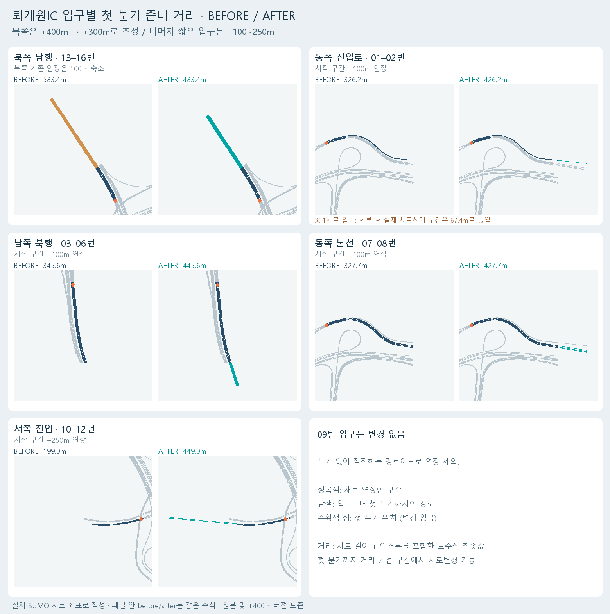

# 퇴계원IC 입구 준비 거리 조정

원본과 북쪽 +400m 버전을 모두 보존하고, 이 폴더를 새 비교 맵으로 만들었다.
북쪽 남행은 **원본 대비 +300m**로 조정했다. 이전 +400m 버전보다 100m 짧다.
나머지 유효 입구도 첫 분기까지 거리를 조사하여 400m 이하인 곳만 추가 연장했다.

| 입구 / 경로 | 직전 버전의 첫 분기 거리 | 이번 변경 | 최종 거리 |
|---|---:|---:|---:|
| 북쪽 남행 / 13–16 | 583.44m | 이전 연장에서 −100m | 483.44m |
| 동쪽 1차로 진입 / 01–02 | 326.22m | +100m | 426.22m |
| 남쪽 북행 / 03–06 | 345.59m | +100m | 445.59m |
| 동쪽 본선 / 07–08 | 327.67m | +100m | 427.67m |
| 서쪽 진입 / 10–12 | 199.02m | +250m | 449.02m |
| 동쪽 직진 / 09 | 첫 분기 없음 | 유지 | — |

거리 정의는 시작점에서 **서로 다른 다음 edge로 나뉘는 첫 분기**까지의 차로 길이와 연결부 길이다. 차로별 길이가 다른 곳은 짧은 차로 및 연결부 길이를 사용한 보수적 기준이다. 09번의 751.22m는 출구까지 거리이며 분기 거리가 아니다.

## 유지한 것과 한계

- 16개 경로, 기존 도로의 모든 점, 내부 차로, 분기·합류 연결, 우선권, 속도, 차폭, 통행·차로변경 권한은 유지했다.
- 외부 진입 edge의 시작점을 접선 방향으로 연장했다. 기존 분기 위치는 옮기지 않았다.
- **01·02번은 1차로 진입로**다. 시작점까지 거리가 늘어도 합류 후 실제 차로를 고르는 `169929488#0` 구간은 67.40m다. 총 접근 거리 증가를 모두 차선 변경 가능 거리로 해석하면 안 된다.
- 고가 표현용 맵에도 같은 XY 연장을 적용했다. 추가 구간 높이는 각 기존 입구의 z를 유지한 가정이며 실측 고도 재현이 아니다.
- 기존 구간의 실선/점선 설정은 보존했다. 새 준비 구간에는 기본 차로 경계를 사용한다.
- 추가 길이가 AV 완주를 개선하는지는 별도 평가 대상이다. AV 학습은 재개하지 않았다.

## 열기

- `review.sumocfg`: 기본 맵.
- `landscape.sumocfg`: 고가·주변 장식 표시. 장식은 원본 폴더 파일을 공유한다.
- `../../scenarios/hv_high15000_entryprep/run.sumocfg`: 이 맵 형상의 **HV 15,000대/h 검증 설정**. review의 routes와 구분한다.

재생성: `python -X utf8 -m utils.extend_entry_preparation` (새 폴더가 없을 때만 실행).
비교도: `python -X utf8 -m utils.render_entry_preparation`.
원본 맵 `../toegyewon_only`, 이전 맵 `../toegyewon_north400`는 그대로다.
각 network의 `*.entry-audit.json`에 변경 전후 길이·해시·연장 내역을 저장했다.

## HV 검증 결과

시간당 15,000대의 기존 본선 중심 수요를 유지했다. 1시간 투입 seed 7201·7202·7203, 2시간 투입 seed 7301·7302·7303의 총 6회에서 **135,000 / 135,000대 완주**했다. 모든 실행의 16개 경로에서 계획·투입·도착 대수가 같았고 충돌·텔레포트·종료 시 대기 및 잔류 차량은 0이었다. 평균 출발 지연은 실행별 0.190–0.241초다. 단기 정지 자체가 없었다는 의미나 모든 교통 수요에서의 보장은 아니다.

[실행별 결과 CSV](../../docs/experiments/ic-hv-entryprep-results-20261113.csv). 원시 결과는 로컬 `results/hv_high15000_entryprep_hour`, `results/hv_high15000_entryprep_long`에 보존한다. 코드 회귀검증 6개와 landscape SUMO 설정 로드도 통과했다.
