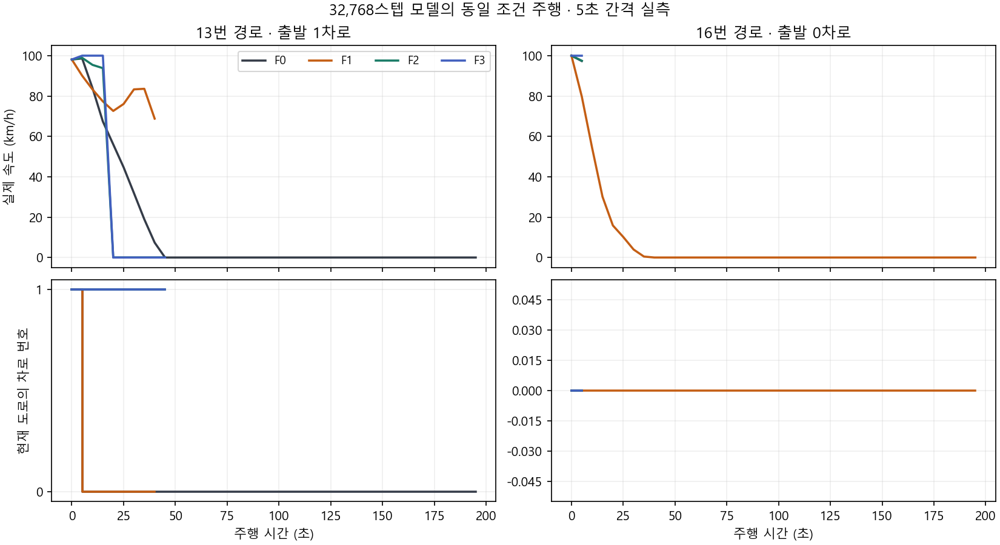

# 순수 PPO의 전진 보상과 두 번째 분기 안내

F0는 기준, F1은 경로 전진 보상(+2/완주 거리), F2는 다음 두 번째 분기 방향·거리 관측, F3는 두 변경을 결합했다. 고교통 16개 경로, 1,000스텝 상한, 동일 초기 가중치의 52차원 정책을 사용했다. 주행 평가는 확률 최대 행동을 선택했다.

## 학습 시드 11 · 네 조건 비교

|조건·시드·스텝|완주|충돌|일반 시간초과|잘못된 차로 끝 정지|전방이 빈 저속 시간¹|실제 차로변경/주행|13·14번 최종 분기²|16번 0차로 명령→변경→본선→완주³|
|---|---:|---:|---:|---:|---:|---:|---|---|
|F0_0|10/64 (15.6%)|24/64 (37.5%)|8/64 (12.5%)|22/64 (34.4%)|24.41초|0.0|0/4 · 0/4|0 → 0 → 0 → 0 (총 2건)|
|F1_0|10/64 (15.6%)|24/64 (37.5%)|8/64 (12.5%)|22/64 (34.4%)|24.41초|0.0|0/4 · 0/4|0 → 0 → 0 → 0 (총 2건)|
|F2_0|10/64 (15.6%)|24/64 (37.5%)|8/64 (12.5%)|22/64 (34.4%)|23.6초|0.0|0/4 · 0/4|0 → 0 → 0 → 0 (총 2건)|
|F3_0|10/64 (15.6%)|24/64 (37.5%)|8/64 (12.5%)|22/64 (34.4%)|23.6초|0.0|0/4 · 0/4|0 → 0 → 0 → 0 (총 2건)|
|F0_8192|16/64 (25.0%)|22/64 (34.4%)|0/64 (0.0%)|26/64 (40.6%)|12.19초|0.0|0/4 · 0/4|0 → 0 → 0 → 0 (총 2건)|
|F1_8192|10/64 (15.6%)|27/64 (42.2%)|8/64 (12.5%)|19/64 (29.7%)|31.23초|0.0|0/4 · 0/4|0 → 0 → 0 → 0 (총 2건)|
|F2_8192|13/64 (20.3%)|30/64 (46.9%)|0/64 (0.0%)|21/64 (32.8%)|9.84초|0.0|0/4 · 0/4|0 → 0 → 0 → 0 (총 2건)|
|F3_8192|14/64 (21.9%)|25/64 (39.1%)|0/64 (0.0%)|25/64 (39.1%)|11.72초|0.0|0/4 · 0/4|0 → 0 → 0 → 0 (총 2건)|
|F0_16384|7/64 (10.9%)|31/64 (48.4%)|14/64 (21.9%)|12/64 (18.8%)|35.2초|0.22|0/4 · 0/4|0 → 0 → 0 → 0 (총 2건)|
|F1_16384|16/64 (25.0%)|16/64 (25.0%)|18/64 (28.1%)|14/64 (21.9%)|50.36초|0.17|0/4 · 0/4|0 → 0 → 0 → 0 (총 2건)|
|F2_16384|15/64 (23.4%)|8/64 (12.5%)|17/64 (26.6%)|24/64 (37.5%)|53.68초|0.0|0/4 · 0/4|0 → 0 → 0 → 0 (총 2건)|
|F3_16384|5/64 (7.8%)|36/64 (56.2%)|13/64 (20.3%)|10/64 (15.6%)|29.78초|0.0|0/4 · 0/4|0 → 0 → 0 → 0 (총 2건)|
|F0_32768|5/64 (7.8%)|18/64 (28.1%)|38/64 (59.4%)|3/64 (4.7%)|95.35초|0.25|0/4 · 0/4|0 → 0 → 0 → 0 (총 2건)|
|F1_32768|10/64 (15.6%)|33/64 (51.6%)|11/64 (17.2%)|10/64 (15.6%)|35.56초|0.27|0/4 · 0/4|0 → 0 → 0 → 0 (총 2건)|
|F2_32768|9/64 (14.1%)|10/64 (15.6%)|28/64 (43.8%)|17/64 (26.6%)|69.38초|0.08|0/4 · 0/4|0 → 0 → 0 → 0 (총 2건)|
|F3_32768|4/64 (6.2%)|31/64 (48.4%)|22/64 (34.4%)|7/64 (10.9%)|63.47초|0.0|0/4 · 0/4|0 → 0 → 0 → 0 (총 2건)|

¹ 속도 0.5m/s 이하이며 같은 차로 앞차가 없거나 25m 초과인 시간의 64회 평균. 양보 대기도 포함될 수 있다. 충돌로 일찍 끝나면 누적 시간도 짧아진다.
² 자연 출발에서 각 경로의 최종 선택 도로로 들어간 횟수. ³ 지표는 행동 횟수가 아니라 각 단계에 도달한 에피소드 수다.

## 실제 주행

도표는 시드 11의 32,768스텝 모델, 13번 평가 회차 1과 16번 회차 0을 5초 간격으로 표시한다. 도로가 바뀌면 차로 번호도 새 도로 기준으로 기록된다.

## 51m 공통 접근 도로 국소 재생

13·14번을 같은 위치·속도에서 시작시켰다. 차로 0·1·2와 교통 시드 2개를 조합한 6쌍이다. 자연 출발 평가와 별도로 집계했다.

|조건|13번 최종 분기|14번 최종 분기|두 경로 모두 통과|
|---|---:|---:|---:|
|F0|0/6|0/6|0/6|
|F1|0/6|0/6|0/6|
|F2|2/6|0/6|0/6|
|F3|3/6|0/6|0/6|

## 독립 검증 · 학습 시드 22·33

F0와 F2를 각 65,536스텝까지 학습하고 32,768·65,536스텝에서 같은 새 교통 시드로 평가했다. 각 행은 64회다.

|조건·시드·스텝|완주|충돌|일반 시간초과|잘못된 차로 끝 정지|전방이 빈 저속 시간¹|실제 차로변경/주행|13·14번 최종 분기²|16번 0차로 명령→변경→본선→완주³|
|---|---:|---:|---:|---:|---:|---:|---|---|
|F0_22_32768|6/64 (9.4%)|22/64 (34.4%)|27/64 (42.2%)|9/64 (14.1%)|76.03초|0.22|0/4 · 0/4|0 → 0 → 0 → 0 (총 2건)|
|F0_22_65536|2/64 (3.1%)|29/64 (45.3%)|26/64 (40.6%)|7/64 (10.9%)|72.29초|0.08|0/4 · 0/4|0 → 0 → 0 → 0 (총 2건)|
|F2_22_32768|8/64 (12.5%)|24/64 (37.5%)|17/64 (26.6%)|15/64 (23.4%)|50.58초|0.0|0/4 · 0/4|0 → 0 → 0 → 0 (총 2건)|
|F2_22_65536|6/64 (9.4%)|13/64 (20.3%)|32/64 (50.0%)|13/64 (20.3%)|91.88초|0.02|0/4 · 0/4|0 → 0 → 0 → 0 (총 2건)|
|F0_33_32768|0/64 (0.0%)|24/64 (37.5%)|39/64 (60.9%)|1/64 (1.6%)|86.59초|0.25|0/4 · 0/4|0 → 0 → 0 → 0 (총 2건)|
|F0_33_65536|11/64 (17.2%)|34/64 (53.1%)|14/64 (21.9%)|5/64 (7.8%)|39.7초|0.45|1/4 · 0/4|0 → 0 → 0 → 0 (총 2건)|
|F2_33_32768|7/64 (10.9%)|16/64 (25.0%)|27/64 (42.2%)|14/64 (21.9%)|76.23초|0.0|0/4 · 0/4|0 → 0 → 0 → 0 (총 2건)|
|F2_33_65536|4/64 (6.2%)|18/64 (28.1%)|37/64 (57.8%)|5/64 (7.8%)|96.82초|0.16|0/4 · 0/4|0 → 0 → 0 → 0 (총 2건)|
