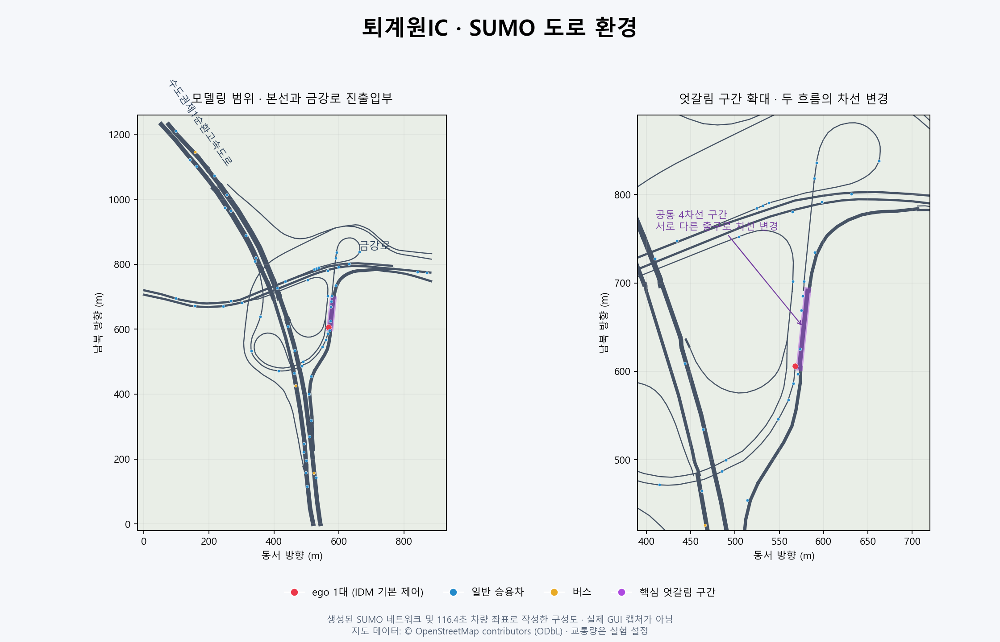

# 퇴계원IC — V / jys 도로 환경

**2026-10-31 추가:** [실선·점선 / 위반 차량 / 긴급 회피 v2](RULES_V2.md), [새 수집 데이터](datasets/rules_v2/README.md). 기존 baseline은 보존했습니다. 지도 판독은 일부 구간만 확인됐으며, 전체 실측 재현으로 취급하면 안 됩니다. v2 실행은 `python scenarios/toegyewon/run_rules.py --gui`입니다.

사용자가 표시한 퇴계원IC의 큰 하단 루프, 작은 상단 루프, 동측 엇갈림 구간과 바깥 진출입부를 구현한 독립 SUMO 시나리오입니다. 기존 `env/sumo/highway`와 학습 설정을 변경하지 않습니다.



## 검증 결과 (2026-10-29)

SUMO 1.27.1에서 시드 0·1·2·7·42 각각 **491대 모두 완주**, 충돌·텔레포트 0, ego 최대 1대를 확인했습니다. 공통 엇갈림 구간의 차선 변경은 각각 61·55·65·66·61회입니다. 도로 연결 및 입체교차 관련 정적 검사 3개도 통과했습니다. 시드 2는 GUI 실행·자동 종료도 확인했습니다. 상세 수치는 `validation.json`에 있습니다.

시드 7에서 3,638개 시간 프레임, 238,099개 차량 상태 레코드를 기록하고 재열기·시간 순서·수치 유효성을 검사했습니다. 이는 합성 교통량에서의 기본 제어기 검증이며, 실제 도로 안전성이나 강화학습 성능을 입증하는 결과가 아닙니다.

## 바로 실행

Windows에서는 이 폴더의 **`open_sumo.cmd`를 더블클릭**하고 SUMO에서 재생 버튼을 누릅니다. macOS/Linux에서는 `sumo-gui -c scenarios/toegyewon/toegyewon.sumocfg`를 실행합니다.

- 빨강: `ego` **1대**, 30초에 진입. 현재는 SUMO IDM 기본 제어기이며 학습된 AI가 아닙니다.
- 파랑: 일반 승용차(Krauss), 노랑: 버스(IDM). 배경 차량 중 버스 비율은 5%입니다.
- 화면에서 차량은 식별을 위해 2배 크기로 그립니다. 실제 물리적 차량 크기는 그대로입니다.
- ego가 출구로 나가면 새 ego를 반복 생성하지 않습니다. 다시 보려면 시뮬레이션을 재시작합니다.

저장소 루트에서 다음 명령으로 재생성·검증·기록할 수 있습니다. Python 환경에는 기존 `requirements.txt`의 sumolib/traci가 필요합니다.

```powershell
python scenarios/toegyewon/build.py
python scenarios/toegyewon/test_scenario.py
python scenarios/toegyewon/run.py --seed 7 --record
```

SUMO 실행 파일은 PATH, SUMO_HOME, Windows 기본 설치 위치 순으로 찾습니다. 기록 없이 검증할 때는 `python scenarios/toegyewon/run.py --seed 42`를 실행합니다.

## 도로 범위와 핵심 상호작용

- 좌표 경계: 동경 127.128–127.138, 북위 37.6345–37.6455. 약 동서 0.88km × 남북 1.22km 범위입니다.
- 수도권제1순환고속도로 양방향, 금강로 양방향, IC 연결램프를 포함합니다. 경계 바깥은 열린 진출입부로 절단했습니다.
- `nw_to_east`: 북서측 본선 → 하단 루프 → 엇갈림 구간 → 동측 금강로. 빨간 ego의 경로입니다.
- `south_to_west`: 남측 본선 → 북향 램프 → 같은 엇갈림 구간 → 상단 루프 → 서측 금강로.
- SUMO edge `170059994`가 공통 4차선 구간입니다. 하단 루프 차량은 왼쪽 차로로 들어와 동측 출구 쪽으로 이동하고, 남측에서 들어온 차량은 상단 루프 방향 차로로 이동해야 합니다. 두 흐름의 차선 변경 상호작용이 발생합니다.
- 그 외 본선 양방향 직진, 금강로 양방향 직진, 서측 금강로→남측 본선까지 총 7개 수요 경로를 제공합니다.

## 실제 자료와 시뮬레이션 가정

| 항목 | 출처 / 처리 |
| --- | --- |
| 도로 중심선·곡선·연결·일방통행 | 2026-10-29 OpenStreetMap 스냅샷 |
| 차선 수·제한속도 | OSM 태그가 있으면 사용. 최신 현장 정보와 일치하는지는 추후 검증 필요 |
| 누락 차선 | 연결램프 1차선, 금강로 2차선으로 가정 |
| 누락 제한속도 | 연결램프 40km/h, 금강로 60km/h로 가정 |
| 차선별 연결·합류부 형태 | SUMO netconvert가 추정. 핵심 엇갈림 연결은 자동 테스트로 확인 |
| 교통량·차종 비율·운전자 설정 | 실측이 아닌 상호작용 실험용 설정. `parameters.json` 참고 |
| 고가 교차 | OSM의 서로 다른 노드/연결을 유지해 평면교차를 방지. 절대 고도/종단경사는 모델링하지 않음 |

상대 layer 값을 높이로 바꾸는 실험은 일부 도로에 10% 이상의 인위적 경사를 만들어 채택하지 않았습니다. 현재 2D 위상만 보존하며, 표시되는 도로가 교차한다고 그 자리에서 차가 갈아타는 것은 아닙니다. 3D 교량 상판이나 현실적인 경사 모델은 별도 작업입니다.

netconvert는 평행 합류·분기점 5곳에서 교차로 모양이 OSM 노드 위치에서 약 25–42m 떨어졌다는 경고를 냅니다. 시뮬레이션 실행 오류는 아니지만, 정확한 합류 시작점·엇갈림 길이·차선 유도선을 확정하려면 최신 항공사진/로드뷰와 대조해야 합니다. 현재 버전을 측량 수준의 디지털 트윈으로 간주하면 안 됩니다.

## 설정과 기록

`parameters.json`에서 수요와 기본값을 바꾼 뒤 `build.py`를 실행합니다. 기본 배경 수요는 총 2,920대/시간이며 600초 동안 차량을 생성하고, 최대 추가 300초 동안 남은 차량을 비웁니다. 학습 스텝 수와 무관한 시뮬레이션 길이입니다.

`run.py --record` 결과는 `results/seed_<숫자>/`에 저장되며 Git에서는 제외됩니다.

- `summary.json`: 투입·도착·충돌 관여 차량 수·텔레포트·ego 완주·엇갈림 차선 변경 횟수
- `tripinfo.xml`: 차량별 주행 시간, 대기시간 등 SUMO 원본 출력
- `lanechanges.xml`: 차선 변경 이벤트, 차간격 등 SUMO 원본 출력
- `telemetry.jsonl.gz`: 0.2초 간격 모든 활성 차량의 좌표·속도·가속도·방향·차로·경로

GUI를 함께 실행하려면 `--gui`를 추가합니다. 캡처는 SUMO의 카메라 버튼을 이용하세요. 자동 캡처는 이 PC의 GUI 실행에서 대기를 유발해 실행기에 포함하지 않았습니다.

이 기록은 **도로 검증용 시뮬레이터 상태 데이터**입니다. 50m 센서 관측, 행동, 보상, 종료 여부를 담는 기존 POMDP 학습 데이터셋과 다릅니다. 기본 데이터 기록은 마련했지만 수업의 필수 학습 데이터 수집까지 완료했다고 간주하지 않습니다.

## 다음 단계

2026-10-29: [IC 전용 기본 제어기 데이터 수집기](COLLECTION.md)를 추가했습니다. 관측·실현 행동·보상·다음 관측·종료/중단과 전체 상태를 기록하며, 기존 PPO/POMDP 환경과는 별도 형식입니다.

- [ ] 항공사진/로드뷰로 실제 차선 수, 합류·분기 시작점, 출구 제한, 제한속도 확인
- [ ] `SumoHighwayEnv`의 직선 고속도로 가정을 바꿔 이 시나리오와 연결
- [ ] 목표 출구·연결 차로·분기까지 거리 및 램프 차량 관측 설계
- [x] IC 전용 기본 제어기 관측/실현 행동/보상/종료 데이터 수집
- [ ] 기존 PPO/BC용 관측·행동 어댑터 및 학습 정책 데이터 수집 연결
- [ ] 학습된 PPO를 빨간 ego 1대에 적용하고 별도 평가

회의록의 자동 전사에는 ‘대관령/대관원 IC’라는 오류가 있으므로 사용자 지시와 첨부 지도에 따라 퇴계원IC를 구현했습니다. 다른 팀원 브랜치와 main은 수정하지 않습니다.

## 출처 및 라이선스

- 지도: [OpenStreetMap 퇴계원IC](https://www.openstreetmap.org/#map=17/37.6402/127.1341), © OpenStreetMap contributors, [ODbL 1.0](https://opendatacommons.org/licenses/odbl/1-0/).
- 원자료 요청 범위: `https://www.openstreetmap.org/api/0.6/map?bbox=127.125,37.631,127.147,37.650` (2026-10-29).
- `source.osm.xml`은 해당 응답에서 관련 도로 56개와 참조 노드를 선택한 스냅샷입니다. OSM 파생 지도 데이터 및 생성 네트워크를 재배포할 때 출처와 ODbL 의무를 유지하세요.
- 변환: [SUMO 공식 OSM 가져오기 문서](https://sumo.dlr.de/docs/Networks/Import/OpenStreetMap.html). 기본 변환은 차선 연결을 추정하므로 검증이 필요합니다.
